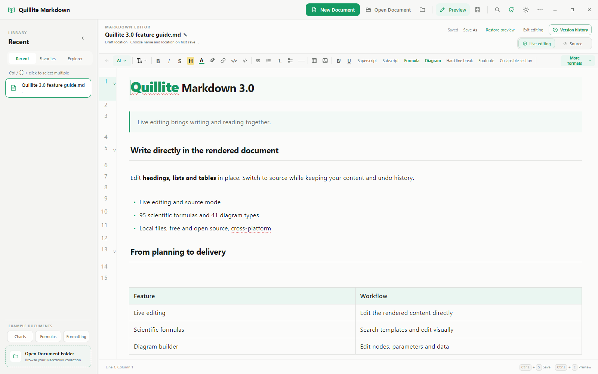
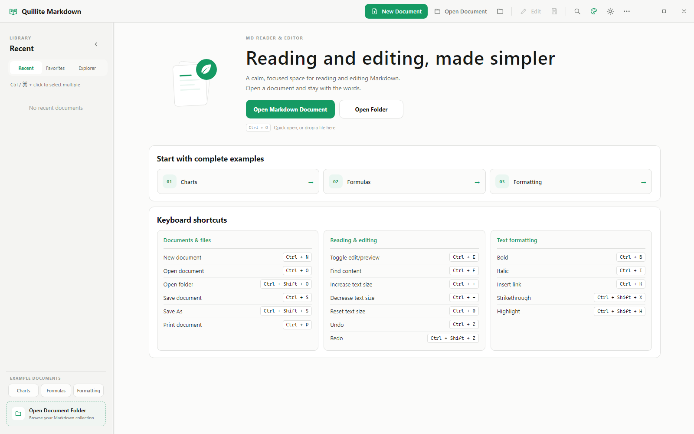
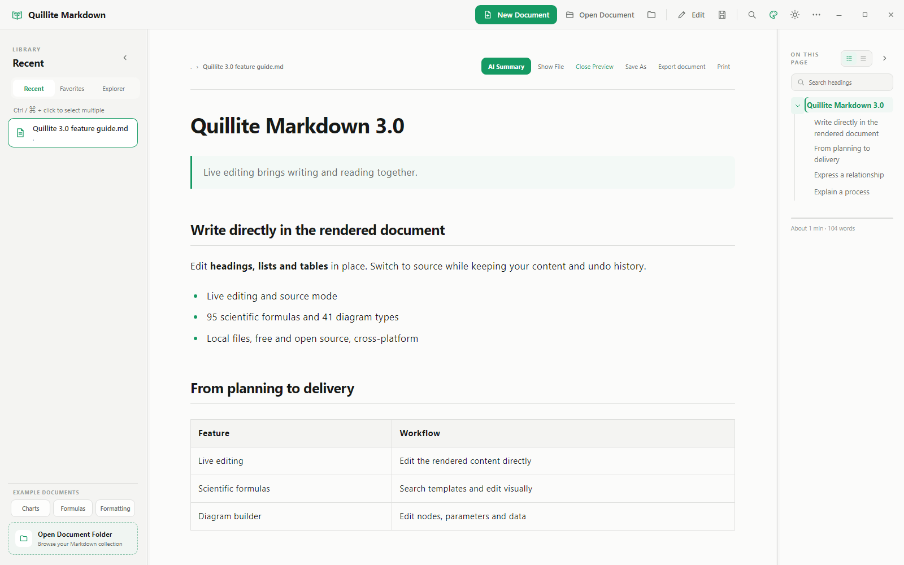
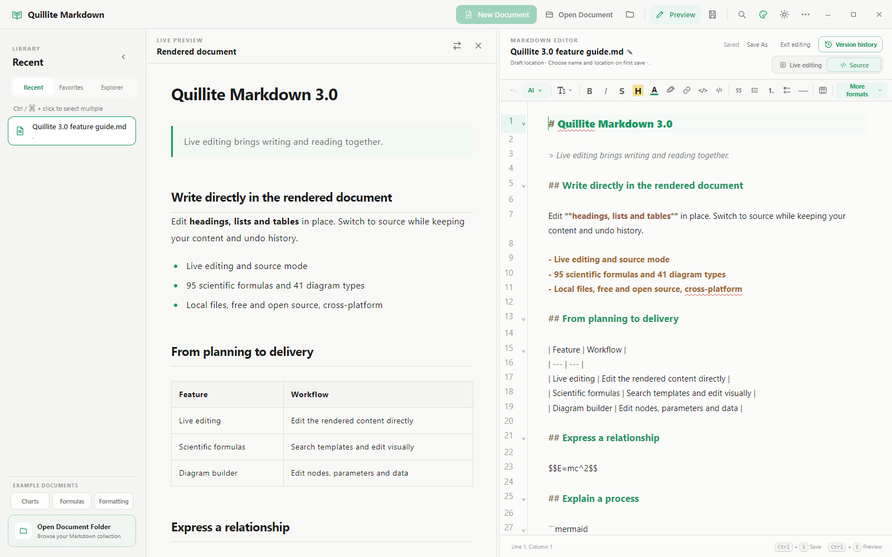

<div align="center">
  
  <h1>Quillite Markdown</h1>
  <p><strong>A local Markdown workspace for focused reading and comfortable editing.</strong></p>
  <p>Live-rendered editing · Source and split preview · Charts and equations · Windows, macOS, Linux</p>
  <p><a href="README.md">简体中文</a> · <strong>English</strong></p>
  <p>
    <a href="https://github.com/liuhang798/quillite-markdown/actions/workflows/release.yml"></a>
    <a href="https://qm.ssssa.cn/#download"></a>
    <a href="LICENSE"></a>
  </p>
  <p><a href="https://qm.ssssa.cn/">Official website</a> · <a href="https://qm.ssssa.cn/#download">Download</a> · <a href="#quick-start">Quick start</a> · <a href="#development">Build from source</a></p>
</div>

Quillite Markdown is built with Go + Wails, without Electron. The Windows installer is about 13 MB. Read long documents, write READMEs, maintain technical notes and browse local Markdown folders; plain-text `.txt` files are supported too. Documents stay in local files, and no Quillite account is required.

The current release is **V3.0.0**. This page describes current behavior; historical changes are available in the [changelog](CHANGELOG.md) and [complete v3.0.0 record](docs/releases/3.0.0-details.md).

## Download

| Platform | Package | Official download |
|---|---|---|
| Windows x64 | Step-by-step `.exe` installer | [Download for Windows](https://qm.ssssa.cn/#download) |
| macOS Intel / Apple Silicon | Universal `.dmg` | [Download for macOS](https://qm.ssssa.cn/#download) |
| Linux x64 | `.deb`, `.AppImage` | [Download for Linux](https://qm.ssssa.cn/#download) |

- **[qm.ssssa.cn](https://qm.ssssa.cn/)** is the official website and the app's only update/download channel. GitHub retains source code, release records and build assets.
- Windows installation shows the final destination before confirmation. A custom ordinary folder is treated as a parent for a dedicated product directory. Upgrades reuse only a validated installation directory; uninstalling preserves user documents.
- Formal Windows Authenticode / Apple Developer ID certificates are not configured. SmartScreen or Gatekeeper may display warnings. Updates or file access may require authorization depending on the operating system; a prompt-free experience is not guaranteed.
- Windows and macOS support in-app downloading, verification and updates. Use the full official installer when an update cannot be applied safely. **Replacing a release under the same version does not trigger a newer-version notification**; users of an earlier V3.0.0 build can download the current V3.0.0 installer again.

## Quick start

Leaving the editor restores the pre-edit reading position instead of jumping to the top. Newly opened documents still start at the top.

1. Choose Open document to read a file, or New document to start editing. The first manual save asks for a name and location.
2. Use Live editing / Source at the lower right of the editor header. The table below describes explicit mode actions.
3. Insert tables, images, equations or charts from the toolbar; additional actions move into More formatting when space is limited.
4. Press `Ctrl + S` (`⌘ + S` on macOS). Autosave runs every 10 seconds while editing, but pauses automatic overwriting when external changes require conflict resolution.
5. Choose Export document for output options. The home screen and lower sidebar provide chart, equation and formatting examples.

| Action | Editing area | Split preview |
|---|---|---|
| Click Live editing | Edit rendered Markdown directly | Closes automatically for full-width editing |
| Click Source | Show Markdown syntax; long Base64 image payloads still use compact labels | Opens automatically in the remembered orientation |
| Click Restore preview or the preview close button | Keep the current editing mode | Open or close independently; subsequent typing preserves this choice |
| Press `Ctrl / ⌘ + E` | Switch between editing and the full reading preview | Separate from the Live editing / Source control |

Switching modes preserves content, selection and undo history. The app remembers the mode and layout; leaving and reentering editing retains manual choices. Clicking a mode button again reapplies its automatic preview behavior. Swap the split orientation or drag the divider to adjust pane widths.

## Features

### Live-rendered and source editing

- Headings, prose, emphasis, lists, quotes, tasks, code and tables render in the editing area. The text-style menu offers prose and H1–H6.
- Click, select and type inside table cells and code without expanding an entire block into source. Code retains its background, and block controls appear on hover or keyboard focus.
- View source / Return to rendered view operates on individual blocks. Complex or unfinished syntax keeps an editable source fallback.
- Shared undo/redo, IME input, formatting shortcuts, multiple selections, find/replace and rich-text paste from web pages or Word.
- Live editing is not a promise of full WYSIWYG support for every Markdown extension: plain text, some complex syntax and oversized prose use source fallback.

### Tables, images and attachments

- The visual table designer supports row/column changes and ordering, column alignment and widths. In-place cells can be emptied and edited again.
- Paste regular TSV or HTML text tables with empty cells, alignment and undo preserved. Unsupported merged cells or complex media tables are rejected with feedback instead of overwriting content.
- Use local attachments, online URLs, reference images or embedded Base64 images. Adjust size, alignment and image rows, including images inside tables.
- Long Base64 image payloads appear as format/size labels even in source mode. **Only their display is condensed; copying and saving preserve the complete image data.**
- Images default to the document's `assets` directory. Embedded storage, PicGo Cloud and local PicGo are optional; failed cloud uploads fall back to the saved local attachment.
- Portable Markdown embeds supported local images into a new copy without modifying the original or deleting attachments. Online, missing or complex references stop the export with feedback.

### 41 chart types and 95 equation templates

- **22 Mermaid types + 19 ECharts data charts**: flowcharts, sequence diagrams, Gantt charts, mind maps, bar/line charts, pie charts, histograms, calendar heatmaps and more.
- Common types provide canvas or data-table editing; complex syntax retains source editing and preview. Flowcharts include input/output parallelograms.
- Charts render directly in the editor. Edit chart / View source updates the original engine and Markdown fence.
- **95 equation templates** cover mathematics, physics and chemistry, with visual structures, parameters, inline/display/numbered output, and local KaTeX / mhchem rendering.
- Built-in examples are organized by category. The current selector and examples define supported templates; not every advanced chart configuration can be converted to a visual form.

### Reading and document management

- Searchable, collapsible document outlines, document search, zoom, eight accent colors, light/dark themes and Chinese/English interfaces.
- Recent, Favorites and a folder explorer. Recent supports pinning, ordering and `Ctrl / ⌘` multi-selection removal; removing records does not delete files.
- Rename, Save As, history versions and crash recovery. Restored content first enters the editor and is written to disk only after saving.
- Compare disk changes with current edits, save a separate copy or merge manually instead of silently overwriting another application's changes.
- Deferred highlighting and preview optimizations for large documents. Hidden split previews stop automatic rendering and show fresh content when restored.

### Export and optional assistance

- One export entry point provides Word, styled/unstyled HTML, PDF, high-resolution PNG/JPEG and portable Markdown.
- PDF prefers installed Edge / Chrome / Chromium, with system printing as fallback. Optional local Pandoc adds EPUB, RTF, ODT, LaTeX and other formats.
- Offline English spell checking and a personal dictionary, plus document checks, folder search and preview-confirmed batch replacement.
- Optional AI editing and review use your configured provider and API key. Select the scope and confirm sending; review and undo the result. Keys use system credential storage, not documents or ordinary preferences.

## Markdown support

| Category | Main formats |
|---|---|
| Text | Bold, italic, strikethrough, highlight, text color, underline, superscript/subscript, inline code |
| Structure | H1–H6, lists, tasks, quotes, rules, code blocks, tables, HTML/collapsible blocks |
| References | Links, reference links, images, footnotes, standalone `[TOC]` |
| Equations and charts | LaTeX, mhchem chemistry, `\tag{…}` numbering, Mermaid, ECharts |

Preview builds on CommonMark/GFM with extensions such as highlights and footnotes. DOMPurify sanitizes HTML; unsafe scripts and URLs are not retained as executable content. Other readers may differ in their support for colors, image layouts, equations and charts.

## Privacy and network boundaries

- Ordinary reading, editing and equation rendering run locally. Online images, update checks and explicitly enabled cloud features require a network connection.
- The product improvement switch controls error reports only. When enabled, reports include path-sanitized errors, system type, version and server-resolved region. Disabling it stops error reporting.
- Anonymous daily activity reporting runs independently, at most once per installation per day, with an installation identifier, version, system type and architecture. The server stores an irreversible identifier hash and resolved region, not the source IP. Documents, names, paths, contact details and specific actions are excluded.
- Feedback sends only user-entered content, explicitly uploaded screenshots, optional contact details and app/system versions. The server records its request IP and region for administrators; the current document is not automatically attached.
- Confirmed AI requests go to the selected provider; image hosting uploads follow the chosen storage mode. Check each provider's privacy and billing policies before use.

## Screenshots

Actual V3.0.0 interface captured with sample documents. Images follow the browser's light/dark preference.

Live-rendered editing: type directly in rendered prose, lists and tables.

<picture>
  <source media="(prefers-color-scheme: dark)" srcset="screenshots/en/dark/04-live-editor.png">
  
</picture>

| Home | Reader |
|---|---|
| <picture><source media="(prefers-color-scheme: dark)" srcset="screenshots/en/dark/01-home.png"></picture> | <picture><source media="(prefers-color-scheme: dark)" srcset="screenshots/en/dark/02-reader.png"></picture> |

Source editing with split preview: clicking Source restores the preview, and either pane orientation is available.

<picture>
  <source media="(prefers-color-scheme: dark)" srcset="screenshots/en/dark/03-split-editor.png">
  
</picture>

See Quick start for mode and preview behavior. The [full screenshot gallery and capture notes](screenshots/README.md) include Chinese/English and light/dark variants.

## Development

Stack: **Go 1.25, Wails 2.13, Node.js 22, Vite and CodeMirror 6**. Install Wails' platform-specific system dependencies as well.

From the repository root:

```bash
go install github.com/wailsapp/wails/v2/cmd/wails@v2.13.0
cd frontend
npm ci
cd ..
wails dev
```

Tests and production frontend build:

```bash
cd frontend
npm test
npm run build
cd ..
go test ./...
go vet ./...
node scripts/test-release-safety.mjs
```

Build the frontend before Go tests so `frontend/dist` exists for embedding. Browser regressions use isolated synthetic documents and require Playwright and Chromium; optionally configure `PLAYWRIGHT_MODULE` and `BROWSER_EXECUTABLE`. The mode/preview regression is `frontend/tests/browser-mode-preview-link.mjs`; see [testing notes](docs/testing.md) for other suites.

A complete Windows installer requires both PowerShell steps:

```powershell
$version = (Get-Content wails.json | ConvertFrom-Json).info.productVersion
$installer = "build/bin/quillite-markdown-$version-windows-amd64.exe"
wails build -clean -platform windows/amd64 -nsis -installscope user -webview2 embed -trimpath
./scripts/build-windows-launcher.ps1 -CoreInstaller $installer -Output $installer
```

The raw NSIS core is not the deliverable. The wrapper validates the custom launcher and `QUILLITE_PAYLOAD` marker. Never run install/upgrade/uninstall lifecycle tests on your everyday machine; those scripts require disposable GitHub-hosted Windows runners.

Universal macOS build:

```bash
bash scripts/build-macos.sh darwin/universal
```

See the [release guide](RELEASING.md) for publishing and website synchronization. Documentation-only changes do not require moving release tags or republishing installers.

## Project documentation

- [Changelog](CHANGELOG.md) · [Complete v3.0.0 record](docs/releases/3.0.0-details.md)
- [Contributing](CONTRIBUTING.md) · [Testing notes](docs/testing.md) · [Security policy](SECURITY.md)
- [AI technical guide](AGENTS.md) · [Release guide](RELEASING.md)
- [Development-branch memory optimization, print-image readiness and validation](docs/resource-lifecycle.md)
- [Website source](https://github.com/liuhang798/quillite-markdown-website)
- [MIT License](LICENSE)
