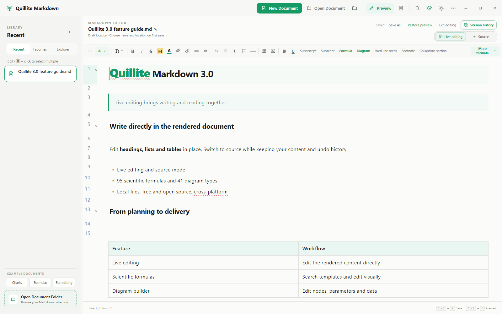
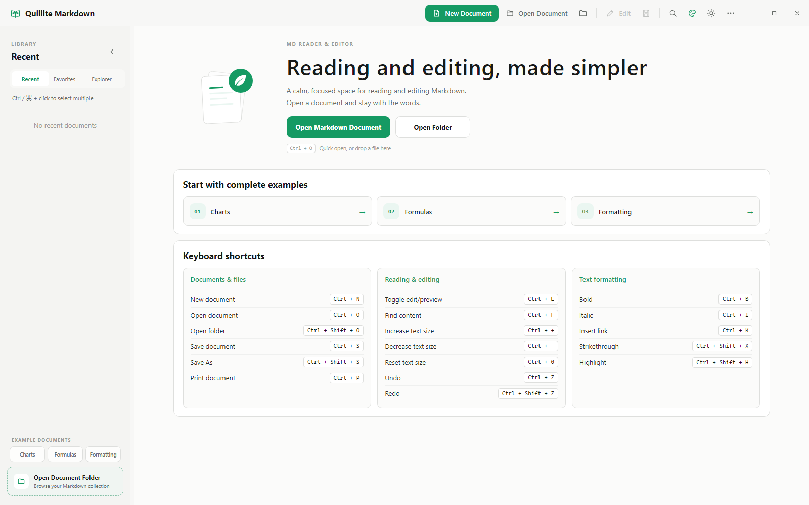
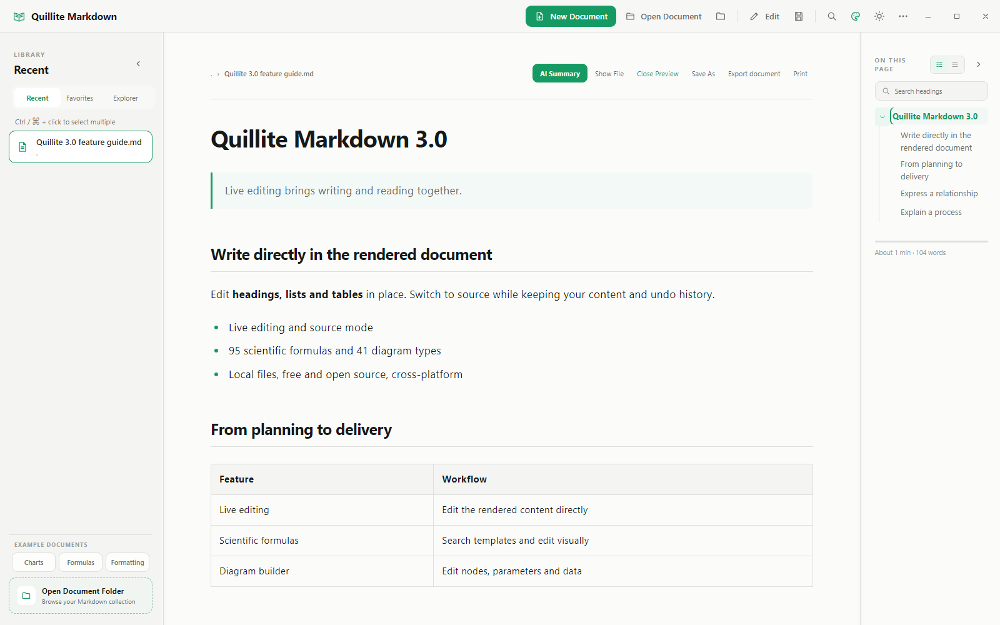
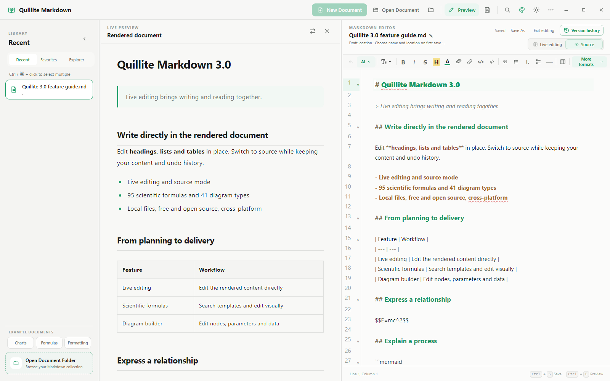

<div align="center">

  
  <h1>Quillite Markdown</h1>
  <p><strong>A local Markdown workspace for focused reading and comfortable editing.</strong></p>
  <p>Live-rendered editing · Source and split preview · Charts and equations · Windows, macOS, Linux</p>
  <p><a href="README.md">简体中文</a> · <strong>English</strong></p>
  <p>
    <a href="https://github.com/liuhang798/quillite-markdown/actions/workflows/release.yml"></a>
    <a href="https://qm.ssssa.cn/#download"></a>
    <a href="LICENSE"></a>
  </p>
  <p><a href="https://qm.ssssa.cn/">Official website</a> · <a href="https://qm.ssssa.cn/#download">Download</a> · <a href="#quick-start">Quick start</a> · <a href="#development">Build from source</a></p>
</div>

The sidebar automatically remembers its last expanded or collapsed state and restores it before first paint, without extra settings or a collapse animation. Split preview follows the caret at a similar relative height; manual preview scrolling pauses following until the next editor interaction.

Charts support an enlarged viewer in reading mode, split preview and the live editor. Click **Enlarge chart**, scroll or use +/− to zoom, and drag to pan; **Fit to window** and **Actual size** reset the view. Mermaid diagrams in reading mode also open on click; data charts retain their legend interactions. Press Esc to close. Viewing does not change document content, chart configuration or export dimensions.

Gantt charts retain their schedule viewport: out-of-range today markers do not stretch the canvas or hide chart content in fitted and actual-size views.

Quillite Markdown is built with Go + Wails, without Electron. The Windows installer is about 13 MB. Read long documents, write READMEs, maintain technical notes and browse local Markdown folders; plain-text `.txt` files are supported too. Documents stay in local files, and no Quillite account is required.

V3.1.0 adds TextPack/TextBundle opening, editing, saving and image-bundled export, chart zoom viewing, remembered sidebar state and improved preview alignment, with Gantt viewport, save-safety and image-loading fixes. See the [changelog](CHANGELOG.md) for details.

## Download

| Platform | Package | Official download |
|---|---|---|
| Windows x64 | Step-by-step `.exe` installer | [Download for Windows](https://qm.ssssa.cn/#download) |
| macOS Intel / Apple Silicon | Universal `.dmg` | [Download for macOS](https://qm.ssssa.cn/#download) |
| Linux x64 | `.deb`, `.AppImage` | [Download for Linux](https://qm.ssssa.cn/#download) |

- **[qm.ssssa.cn](https://qm.ssssa.cn/)** is the official website and the app's only update/download channel. GitHub retains source code, release records and build assets.
- Windows installation shows the final destination before confirmation. A custom ordinary folder is treated as a parent for a dedicated product directory. Upgrades reuse only a validated installation directory; uninstalling preserves user documents.
- Formal Windows Authenticode / Apple Developer ID certificates are not configured. SmartScreen or Gatekeeper may display warnings. Updates or file access may require authorization depending on the operating system; a prompt-free experience is not guaranteed.
- Windows and macOS support in-app downloading, verification and updates. V3.0.0 users can check for updates to V3.1.0; use the full official installer when an update cannot be applied safely. **Replacing a release under the same version does not trigger a newer-version notification**.

## Quick start

Auto, English (US) and English (UK) are listed directly in the Spell check submenu. Click an item to select it; the current dictionary is checked, with no dropdown.

More → Spell check groups misspelling marks, dictionary language and clearing the personal dictionary. Export and Print remain in the reading-page actions (the document actions menu in narrow windows), without duplicate entries in More. Ctrl / ⌘ + P remains available.

Heading equations retain subscripts, superscripts and fractions in the reading outline, editing outline and inline `[TOC]`. Search accepts formula source text; existing section anchors and document content remain unchanged.

Unreleased fixes preserve math delimiters such as `\(...\)` and `\[...\]` during rich-text paste instead of double-escaping their backslashes; ordinary parentheses and code remain literal. Reading-outline tracking coalesces scroll events per frame, measures only a bounded selection of headings and updates only changed active sections. Browser regressions cover the optimization; native Ubuntu behavior still needs device-level verification.

Leaving the editor restores the pre-edit reading position instead of jumping to the top. Newly opened documents still start at the top.

1. Choose Open document to read a file, or New document to start editing. Ctrl / ⌘ + S saves directly to the displayed location, including new and autosaved documents. Use Save As or Ctrl / ⌘ + Shift + S to choose a different name or folder.
2. Use Live editing / Source at the lower right of the editor header. The table below describes explicit mode actions.
3. Insert tables, images, equations or charts from the toolbar; additional actions move into More formatting when space is limited.
4. Press `Ctrl + S` (`⌘ + S` on macOS). Autosave runs every 10 seconds while editing, but pauses automatic overwriting when external changes require conflict resolution.
5. Choose Export document for output options. The home screen and lower sidebar provide chart, equation and formatting examples.

Local Markdown/text links resolve against the current file's directory and open inside the app, including Unicode, spaces, parent directories and section anchors. Web links still use the default browser; missing targets leave the current document open.

| Action | Editing area | Split preview |
|---|---|---|
| Click Live editing | Edit rendered Markdown directly | Closes automatically for full-width editing |
| Click Source | Show Markdown syntax; long Base64 image payloads still use compact labels | Opens automatically in the remembered orientation |
| Click Restore preview or the preview close button | Keep the current editing mode | Open or close independently; subsequent typing preserves this choice |
| Press `Ctrl / ⌘ + E` | Switch between editing and the full reading preview | Separate from the Live editing / Source control |

Switching modes preserves content, selection and undo history. The app remembers the mode and layout; leaving and reentering editing retains manual choices. Clicking a mode button again reapplies its automatic preview behavior. Swap the split orientation or drag the divider to adjust pane widths.

## Features

Rendered exports such as Word, PDF and styled HTML stop if a local image cannot be read. Check the path, location and read permissions, then export again without reopening the document. “Package document with images” still explicitly reports missing resources without promising complete offline use.

### Live-rendered and source editing

The 2026-10-30 rebuild of v3.0.2 fixes false installation-repair prompts for portable EXEs, header overlap from the sidebar opener, and preview positioning for same-line cursor moves and long code blocks. Portable updates offer manual portable EXE downloads without requiring installation. Download this same-version rebuild again; save documents and fully quit the old process before installing or launching it, so single-instance handling does not bring back the old window.

This rebuild also excludes app-owned export dialogs and backdrops from PDF system-print fallback, preserving document content and its legitimate HTML components.

The 2026-10-29 rebuild of v3.0.2 fixes editor tile traversal when rendered widgets change length, preserving document content, undo history and IME safeguards.

- Reading and editing resume at the current viewport in both directions, using source-block anchors instead of an old editing position. Unsaved content and undo history are preserved.
- A collapsible editing outline offers heading search, tree/flat views and chapter navigation. It starts closed and overlays the page without reducing editor width.
- The outline trigger has dedicated space in the rightmost header, keeping version history and preview close controls accessible in either split direction.
- Headings, prose, emphasis, lists, quotes, tasks, code and tables render in the editing area. The text-style menu offers prose and H1–H6.
- Click, select and type inside table cells and code without expanding an entire block into source. Code retains its background, and block controls appear on hover or keyboard focus.
- View source / Return to rendered view operates on individual blocks. Complex or unfinished syntax keeps an editable source fallback.
- Whole-chart selection uses a card border without stray top/left color bars; source-text highlighting and chart copy, delete and undo remain available.
- Shared undo/redo, IME input, formatting shortcuts, multiple selections, find/replace and rich-text paste from web pages or Word.
- Live editing is not a promise of full WYSIWYG support for every Markdown extension: plain text, some complex syntax and oversized prose use source fallback.

### Tables, images and attachments

- The visual table designer supports row/column changes and ordering, column alignment and widths. In-place cells can be emptied and edited again.
- Paste regular TSV or HTML text tables with empty cells, alignment and undo preserved. Unsupported merged cells or complex media tables are rejected with feedback instead of overwriting content.
- Use local attachments, online URLs, reference images or embedded Base64 images. Adjust size, alignment and image rows, including images inside tables.
- Long Base64 image payloads appear as format/size labels even in source mode. **Only their display is condensed; copying and saving preserve the complete image data.**
- Images default to the document's `assets` directory. Embedded storage, PicGo Cloud, local PicGo Server and PicGo CLI are optional; failed uploads fall back to the saved local attachment.
- In v3.0.2, “Save configuration draft” keeps CLI paths and HTTP preferences offline across closing and restarting, without changing active upload settings or uploading a test image. Successfully verify uploading, then explicitly choose “Save & enable” to apply the configuration.
- v3.0.2 reduces idle waiting after managed CLI uploads and shows phases plus elapsed time; transfer speed still depends on the network and host. Successful uploads use online URLs while retaining `assets` backups. Failed uploads and images inserted before hosting was enabled keep local references; existing images are never automatically uploaded.
- In v3.0.2, PicGo CLI login checks existing authorization first and shows separate browser-authorization and validity-check phases. Closing, cancelling or timing out retains the separate profile. Use “Reauthorize / switch account” to change accounts. Login alone does not validate uploads or enable hosting; test and save explicitly.
- CLI “Verify upload settings” automatically uses a built-in test image; no image selection is needed. Success prompts you to “Save & enable”. Cancel or Escape leaves uploading disabled, with a prominent unsaved status and manual saving available while verification remains valid.
- CLI preparation shows real download bytes/percentage, stages and elapsed time. Dependency installation uses an activity indicator rather than a simulated overall percentage. Manual executable paths are in collapsed Advanced settings.
- PicGo CLI runs on demand without a background Server. “Prepare CLI automatically” downloads pinned versions from official Node.js/npm sources after confirmation, verifies them, and installs privately without changing system Node.js, PATH or npm configuration. Windows x64, macOS Intel/Apple Silicon and Linux x64 are supported; internet and several hundred MB of free space are required. Then sign in to PicGo Cloud through the CLI in your browser (a separate profile preserves existing settings), or select a trusted configured CLI `config.json`; blank reuses `~/.picgo/config.json`. Other hosts can still be configured with `picgo set` / `picgo use`. Version detection cannot enable uploading: explicitly upload the built-in test PNG, obtain a valid URL, then save within 10 minutes. The test image remains on the host until you remove it. Existing absolute CLI paths are supported, including Windows `picgo.cmd` without command arguments. Actual uploads always execute `picgo upload`; HTTPS is required by default. In v3.0.2, HTTP hosts require explicit “Allow HTTP image URLs” risk confirmation, re-verification and saving. URLs are never silently upgraded. Successful uploads insert the original URL while keeping local backups, and failures preserve local assets without retries. Existing local images are not uploaded automatically. v3.0.2 remembers prepared components independently, rediscovers them after closing settings or restarting, and recognizes complete legacy components without automatically enabling uploads.
- Portable Markdown embeds supported local images into a new copy without modifying the original or deleting attachments. Online, missing or complex references stop the export with feedback.

### 41 chart types and 95 equation templates

Live editing records composition start without immediately updating the editor view or resetting the native selection. The first native input transaction adopts this state, and rendering resumes after commit. Nonessential focus, spelling, equation, image and diagram updates wait until composition ends. Nested-editor settings replay in order, and disposal cancels stale callbacks. Code blocks, cross-block input, dragging and mode switching also protect the first phonetic key. The reported macOS candidate-window interruption has been confirmed fixed by the user on their device; other OS/IME combinations still require ongoing regression testing.

Live equations no longer disappear at 300,000 document characters or stop after 256 equations. Large documents are scanned locally in a background worker, and visible equations are typeset in small batches. Choosing Live restores rendered equations; More → Equation display → Equation source and each equation's source action remain available. Source fallback for other complex blocks and equation syntax safety limits are unchanged.

- **22 Mermaid types + 19 ECharts data charts**: flowcharts, sequence diagrams, Gantt charts, mind maps, bar/line charts, pie charts, histograms, calendar heatmaps and more.
- Common types provide canvas or data-table editing; complex syntax retains source editing and preview. Flowcharts include input/output parallelograms.
- Charts render directly in the editor. Edit chart / View source updates the original engine and Markdown fence.
- **95 equation templates** cover mathematics, physics and chemistry, with visual structures, parameters, inline/display/numbered output, and local KaTeX / mhchem rendering.
- Built-in examples are organized by category. The current selector and examples define supported templates; not every advanced chart configuration can be converted to a visual form.

### Reading and document management

- Searchable, collapsible document outlines, document search, zoom, eight accent colors, light/dark themes and Chinese/English interfaces.
- Body & math settings independently control body style, equation size and four body line-spacing presets. Preview before saving or cancel to restore; inline code uses a theme-aware neutral background in reading and live editing.
- Windows Show in Folder selects the full file path without guessing the target from same-named window titles.
- Document lists show the name without its extension on the first line and a type badge plus location on the second, distinguishing TextPack, TextBundle and ordinary Markdown. Long paths truncate without hiding the badge; hover to see complete names and paths. Actual files are never renamed.
- Recent, Favorites and a folder explorer. Recent supports pinning, ordering and `Ctrl / ⌘` multi-selection removal. `Shift + click` selects an inclusive range; `Ctrl / ⌘ + Shift + click` adds a range to the selection. Removing records does not delete files.
- Bulk removal uses a macOS-compatible in-app confirmation dialog from the toolbar, context menu or Delete key. Cancel preserves the selection; failures remain retryable without affecting Favorites or the unsaved document.
- Rename, Save As, history versions and crash recovery. Restored content first enters the editor and is written to disk only after saving.
- Compare disk changes with current edits, save a separate copy or merge manually instead of silently overwriting another application's changes.
- Deferred highlighting and preview optimizations for large documents. Hidden split previews stop automatic rendering and show fresh content when restored.
- Large documents no longer enter a read-only safe mode because of character count or embedded Base64 images: reading, editing, search, printing and export remain available. Marker-free prose avoids redundant parsing; offscreen prose layout and code highlighting are deferred, with lazy image loading. Printing/export explicitly load complete images. Complex large documents may still take time; opening never truncates or rewrites the source.
- Document opening shows a lightweight indicator in the reading area after 300 ms, with an additional waiting hint after 3 seconds. It reports opening, processing and displaying stages without fabricated percentages. The existing page and file list stay visible; rendering yields between stages, and switching/closing documents invalidates stale UI updates.

### Export and optional assistance

- TextPack/TextBundle use the ordinary opening, editing and saving workflow, without separate import/direct-edit modes. Open `.textpack` through **Open**; drag in a TextBundle, select its `.textbundle` directory through **Open folder**, or enter the package in the file picker and select its text document. Ctrl/Command+S and 10-second autosave update the current original package.
- The Windows installer registers the TextPack icon, double-click command and Open With candidate; replacing the editor executable alone does not update these system registrations, so run the new installer. Portable users can explicitly choose **More → Set as default MD app** to register candidates and open Windows Settings. Registration never runs automatically at startup or forcibly replaces a chosen default application.
- **Save As** offers Markdown, TextBundle and TextPack, plus **Plain text** for a current TXT document. It defaults to the current format and extension before opening the system location dialog. Ordinary same-format Markdown backups do not force image collection; TXT copies preserve the exact text without parsing image syntax. Cross-folder Markdown copies still rebase supported image references. Editing continues in the new copy only after success; canceling leaves the current document unchanged. Package-to-package copies retain all resources and third-party metadata without overwriting an existing target. **Markdown (with images)** in the export panel creates an ordinary `.md + assets` copy without switching the current document; **Pack document (with images)** still creates a new `.textpack`. Neither export changes the source.
- Package revisions cover text, images and metadata. External changes pause autosave and require comparison, an explicit merge or a complete copy. Unchanged ZIP entries and original `info.json` bytes are retained; directory saves safely replace only the text and create new images without deleting existing resources.
- Recovery stores the original identity and base revision; complete baselines and new assets remain in the configuration directory’s `bundle-sessions`, with no automatic cleanup. Missing originals can be recovered into complete copies, never silently recreated or overwritten. Workspaces are capped at 64 / 2 GiB total, including a total-budget check before image insertion; each package at 256 MiB, text at 64 MiB and image at 25 MiB. Directory saves explicitly report partial attachment publication if text commit fails, retaining recovery material.
- Online resources still require opt-in and are never downloaded automatically. Outline headings are parsed in inert containers, preventing heading images from bypassing consent when entering the editor. Local image reads stay inside the controlled workspace. Conversion preserves a single UTF-8 BOM without duplicating it on later saves. Portable Markdown, Markdown-with-images and package export/copy destinations cannot be inside the current original package or managed workspaces, and destination-directory symlinks/junctions are not followed; select the real directory directly. Direct package rename and Pandoc-based exports are not supported yet: close the document before renaming in the file manager, or export portable Markdown before using Pandoc. Ordinary rendered exports remain available.
- Version history restores Markdown text while retaining the current package’s attachments and metadata; it is not full-package historical rollback. Crash-recovery baselines and new assets are preserved separately in the durable workspace.
- Packaging and format conversion never download remote images. Missing, outside-package and unverified resources are reported; complete offline availability is not promised. Online images require explicit loading after opening a package. Ordinary Markdown, reference, HTML `img src` and footnote images are supported; complex responsive images such as `srcset` are not supported yet. Conversions create new targets only and reject unsafe paths, links and oversized archives.
- Until network resources are allowed in the package-document session, charts show source and potentially network-bearing styles are disabled; ordinary image layout styles remain. Opting in restores rendering. Printing and rendered exports request permission first. This session-only policy never rewrites the source document.
- One export entry point provides Word, styled/unstyled HTML, PDF, high-resolution PNG/JPEG and portable Markdown.
- PDF prefers installed Edge / Chrome / Chromium, with system printing as fallback. Optional local Pandoc adds EPUB, RTF, ODT, LaTeX and other formats.
- Offline English spell checking and a personal dictionary, plus document checks, folder search and preview-confirmed batch replacement.
- Optional AI editing and review use your configured provider and API key. Select the scope and confirm sending; review and undo the result. Keys use system credential storage, not documents or ordinary preferences.

## Markdown support

| Category | Main formats |
|---|---|
| Text | Bold, italic, strikethrough, highlight, text color, underline, superscript/subscript, inline code |
| Structure | H1–H6, lists, tasks, quotes, rules, code blocks, tables, HTML/collapsible blocks |
| References | Links, reference links, images, footnotes, standalone `[TOC]` |
| Equations and charts | LaTeX, mhchem chemistry, `\tag{…}` numbering, Mermaid, ECharts |

Preview builds on CommonMark/GFM with extensions such as highlights and footnotes. DOMPurify sanitizes HTML; unsafe scripts and URLs are not retained as executable content. Other readers may differ in their support for colors, image layouts, equations and charts.

## Privacy and network boundaries

- Ordinary reading, editing and equation rendering run locally. Online images, update checks and explicitly enabled cloud features require a network connection.
- The product improvement switch controls error reports only. When enabled, reports include path-sanitized errors, system type, version and server-resolved region. Disabling it stops error reporting.
- Anonymous daily activity reporting runs independently, at most once per installation per day, with an installation identifier, version, system type and architecture. The server stores an irreversible identifier hash and resolved region, not the source IP. Documents, names, paths, contact details and specific actions are excluded.
- Feedback sends only user-entered content, explicitly uploaded screenshots, optional contact details and app/system versions. The server records its request IP and region for administrators; the current document is not automatically attached.
- Confirmed AI requests go to the selected provider; image hosting uploads follow the chosen storage mode. Check each provider's privacy and billing policies before use.

## Screenshots

Actual V3.0.0 interface captured with sample documents. Images follow the browser's light/dark preference.

Live-rendered editing: type directly in rendered prose, lists and tables.

<picture>
  <source media="(prefers-color-scheme: dark)" srcset="screenshots/en/dark/04-live-editor.png">
  
</picture>

| Home | Reader |
|---|---|
| <picture><source media="(prefers-color-scheme: dark)" srcset="screenshots/en/dark/01-home.png"></picture> | <picture><source media="(prefers-color-scheme: dark)" srcset="screenshots/en/dark/02-reader.png"></picture> |

Source editing with split preview: clicking Source restores the preview, and either pane orientation is available.

<picture>
  <source media="(prefers-color-scheme: dark)" srcset="screenshots/en/dark/03-split-editor.png">
  
</picture>

See Quick start for mode and preview behavior. The [full screenshot gallery and capture notes](screenshots/README.md) include Chinese/English and light/dark variants.

## Development

Stack: **Go 1.25, Wails 2.13, Node.js 22, Vite and CodeMirror 6**. Install Wails' platform-specific system dependencies as well.

From the repository root:

```bash
go install github.com/wailsapp/wails/v2/cmd/wails@v2.13.0
cd frontend
npm ci
cd ..
wails dev
```

Tests and production frontend build:

```bash
cd frontend
npm test
npm run build
cd ..
go test ./...
go vet ./...
node scripts/test-release-safety.mjs
```

Build the frontend before Go tests so `frontend/dist` exists for embedding. Browser regressions use isolated synthetic documents and require Playwright and Chromium; optionally configure `PLAYWRIGHT_MODULE` and `BROWSER_EXECUTABLE`. The mode/preview regression is `frontend/tests/browser-mode-preview-link.mjs`; see [testing notes](docs/testing.md) for other suites.

A complete Windows installer requires both PowerShell steps:

```powershell
$version = (Get-Content wails.json | ConvertFrom-Json).info.productVersion
$installer = "build/bin/quillite-markdown-$version-windows-amd64.exe"
wails build -clean -platform windows/amd64 -nsis -installscope user -webview2 embed -trimpath
./scripts/build-windows-launcher.ps1 -CoreInstaller $installer -Output $installer
```

The raw NSIS core is not the deliverable. The wrapper validates the custom launcher and `QUILLITE_PAYLOAD` marker. Never run install/upgrade/uninstall lifecycle tests on your everyday machine; those scripts require disposable GitHub-hosted Windows runners.

Universal macOS build:

```bash
bash scripts/build-macos.sh darwin/universal
```

See the [release guide](RELEASING.md) for publishing and website synchronization. Documentation-only changes do not require moving release tags or republishing installers.

## Project documentation

- [Changelog](CHANGELOG.md) · [Complete v3.0.0 record](docs/releases/3.0.0-details.md)
- [Contributing](CONTRIBUTING.md) · [Testing notes](docs/testing.md) · [Security policy](SECURITY.md)
- [AI technical guide](AGENTS.md) · [Release guide](RELEASING.md)
- [Development-branch memory optimization, print-image readiness and validation](docs/resource-lifecycle.md)
- [Website source](https://github.com/liuhang798/quillite-markdown-website)
- [MIT License](LICENSE)
