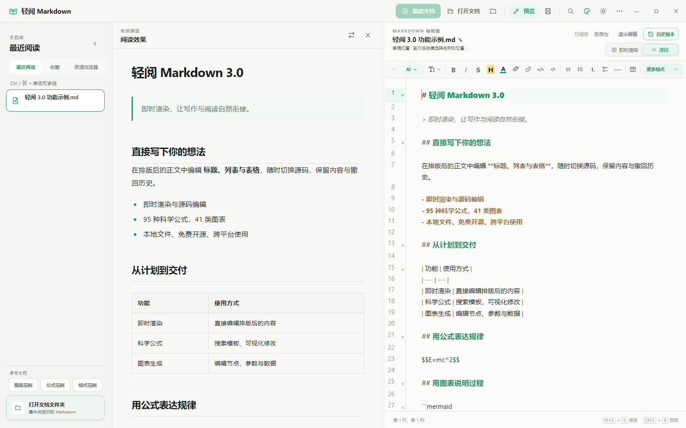
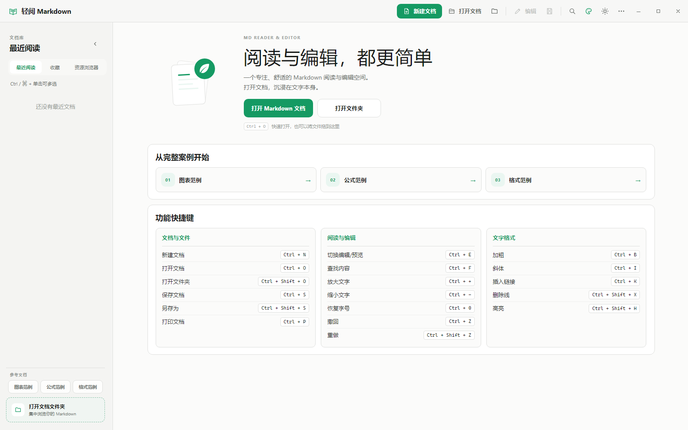
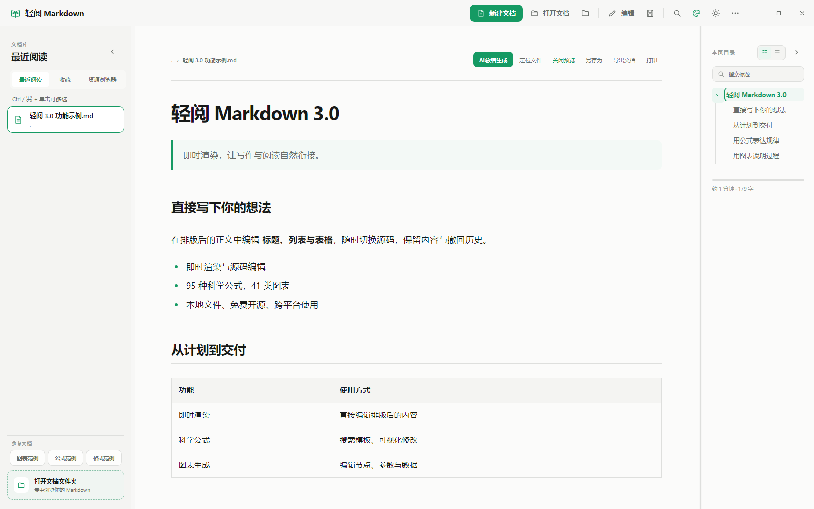

<div align="center">
  
  <h1>轻阅 Markdown</h1>
  <p>图片布局修复：拆分保留引用／列表，多图换行对齐不丢图，Word 保留列表内同排；特殊路径与跨目录另存加载已有回归验证。</p>
  <p><strong>快速、本地优先的 Markdown 阅读器、查看器和编辑器——Windows 安装包约 12 MB。</strong></p>
  <p>实时预览 · 语法高亮 · 本地文件 · Windows、macOS、Linux</p>
  <p><strong>简体中文</strong> · <a href="README.en.md">English</a></p>
  <p>
    <a href="https://github.com/liuhang798/quillite-markdown/actions/workflows/release.yml"></a>
    <a href="https://qm.ssssa.cn/#download"></a>
    <a href="LICENSE"></a>
    
  </p>
  <p>
    <a href="https://qm.ssssa.cn/"><strong>🌐 唯一官方网站：qm.ssssa.cn</strong></a>
    ·
    <a href="https://qm.ssssa.cn/#download"><strong>下载最新版本</strong></a>
    · <a href="#项目截图">查看截图</a>
    · <a href="#本地开发">从源码构建</a>
  </p>
</div>

图片存储设置在四种模式下均显示保存失败提示；失败保留选择，可重试，不改动当前文档。

图片设置保存或登录处理中仍可关闭窗口、调整选择；迟到的响应不会误关重开的窗口或覆盖新选择。保存与登录操作串行执行，连接检查不删除登录凭据。

选图、粘贴或上传等待期间，图片会跟随原始插入位置的文字变动，不追随后来移动的光标；切换文档或退出编辑会取消待插入操作。原选区被修改时不会覆盖新文字。说明和宽度按发起操作时的选择保留，图片插入可独立撤回。

图片返回不会抢走查找／替换框的输入焦点；退出编辑再进入后，已取消请求的返回不再显示过期提醒。

并发上传时，进度显示按请求隔离，旧请求不会覆盖新进度；上传期间修改图床设置不会误改正在上传的服务说明。

重命名后可继续原位编辑公式、图表、表格和脚注，保留未保存文字及撤回历史；另存后的脚注编辑也绑定到新文件。

历史版本读取遵循最后一次选择：关闭重开或切换文档后，旧响应不会覆盖当前预览；读取中及失败时不能恢复上一项。恢复只更改编辑器，可撤回，明确保存后才写入文档。

启动期间也可立即新建或打开文档：后到的启动恢复不会覆盖当前文档或已输入文字，新增最近阅读和置顶记录保持可见。

启动恢复和资源浏览器刷新遵循最新操作：新选文件夹（包括同一路径重新选择）、最新列表和当前侧栏标签不会被迟到结果覆盖。

旧恢复草稿保存在用户配置目录下 `recovery-archives`，与当前编辑快照分离；顶部“恢复草稿”可手动查看，不抢输入焦点。恢复前需先保存当前修改，“稍后处理”不清除备份。在“更多 → 文档工具 → 文档安全”可查看并另存保留的旧草稿。备份只新增、不自动清理，最多 64 份／256 MiB；达到上限或无法备份时会保留原材料并提示手动保存。需要释放空间时请先另存所需草稿，再自行整理该目录。

恢复窗口支持 Tab 循环和 Escape 关闭，阻止后台文档快捷键；读取过程中可取消，迟到结果不会覆盖随后输入。原文件无法读取时恢复为独立新草稿，不误报与原文件冲突；首次保存仍需选择名称与位置。取消已发起的新建请求不会删除可能已经创建的空草稿。

即时渲染代码块内，Tab 增加当前行或选中行的缩进，Shift+Tab 减少缩进；支持多光标并与主文档共用撤回／重做。Escape 返回正文，不改变代码；表格的 Tab 切换单元格行为不变。代码粘贴保留原有制表符、空行和空格，不自动重排代码。

空代码块首次回车或粘贴末尾换行时，用户输入的换行与结束围栏分隔行分别保留，避免接着输入破坏围栏并吞入后续正文；引用、列表、折叠区和脚注同样处理，保留撤回／重做和继续输入位置。

即时渲染表格支持按行列粘贴制表符分隔数据（TSV）或规则 HTML 文字表格，从当前单元格／拖选范围左上角开始覆盖，必要时扩展到最多 20 行（含表头）、12 列；已有更大表格可在原范围内粘贴。保留空单元格、未覆盖内容、列对齐和既有列宽，一步撤回／重做；重做后光标回到最后粘贴单元格末尾。单次最多 50 万字符；合并单元格、非矩形数据、含图片等媒体或表格外混有正文时拒绝本次粘贴并保留原文。成功重试会清除本次粘贴的旧警告，不影响其他操作提示。普通非表格文本仍按单元格规则处理换行。

表格设计器打开或新增行列时立即定位到目标格；随后点击其他单元格输入，不会再被延迟聚焦抢回表头。取消后重新打开也不会执行旧窗口的聚焦请求。

插入图片、图表新增数据行和思维导图新增节点也立即定位输入框；随后切换图片说明、其他数据格或搜索框时，不会被旧的延迟聚焦抢走输入。

流程图和状态图的新增节点也遵循相同规则。三类画布提供隔离鼠标／键盘回归，检查节点与连线编辑、拖动、缩放、结构修改和保存撤回。

> **官方网站与官方下载：<https://qm.ssssa.cn/>**
> 软件更新、三平台安装包、版本日志与意见反馈均由该站提供，不使用其他根域名或 `www` 域名。



稳定性修复：Windows 云盘目录保存不再创建硬链接，失败时仍恢复原文件或保留恢复材料。超长单行图表/公式扫描不会再依赖可能耗尽 WebView 堆栈的整行正则。AI 操作最多支持 200 万 Unicode 字符，超限会在发送前提示拆分；空结果、截断和平台拒答有明确说明。AI 响应超过 8 MiB、SSE 缺少结束标记或中途报错时停止，部分结果不可应用。日志完整隐藏路径，仅保留固定的安全错误类别。打开文件仍限制为 64 MiB；导出被占用或无写权限时请关闭相关程序，或选择可写目录的新文件名。

保存遇到外部修改时，可并排对比“磁盘版本／当前编辑”。保留编辑会暂停自动保存；使用磁盘版本只替换编辑器内容且可撤回；另存副本必须选择新文件名。手动合并先应用到编辑器，再次点击保存后明确确认，期间磁盘再次变化会重新进入对比，不自动覆盖。文件被删除或无法读取时仍保留当前编辑。

## 为什么选择轻阅 Markdown？

主编辑区通过 Ctrl/⌘+D 选择多处相同文字后，行内格式、文字颜色、标题、引用与列表统一处理全部选区，保留方向及单步撤回；同一行只添加一次块级标记。格式刷支持多个目标，按住修饰键连续多选或拖选时不会提前应用。即时渲染中行内格式后直接回车保留文字并在结束标记后换行；内部单元格及复杂跨容器多选仍在审计中。

同排图片共用一个可换行操作面板，按图片序号／说明选择目标，悬停图片也会切换目标；图片聚焦后按 Enter 进入操作，Esc 返回。空间足够时面板避开图片，并限制在编辑区内，源码返回入口始终可用。窄单元格中的图片自动折行，仍保留同一个图片组。

图片操作栏仅淡入、不再上下滑动，刚出现时点击按钮边缘也不会因动画位移点空；查看源码后保留常驻的返回入口。

脚注、折叠正文和代码／表格等嵌套编辑区共用主文档撤回历史；撤回重建内部编辑区时保留键盘焦点，可继续重做，不抢占其他控件焦点。

整块内容拖入脚注时保留目标段落分隔与多层缩进，引用／列表中的代码和表格仍属于原容器。引用内的标准折叠和 HTML 正文区块支持即时编辑，标题、正文换行及内层代码／表格保留引用与脚注前缀，支持源码往返和共享撤回；代码示例中的结束标签不会截断外层区块。

阅读与带样式 HTML 中，含图片的表格使用稳定列宽，避免相邻文字被挤成逐字竖排；手动设置的列宽仍优先。单元格内多图随空间折行，文字顶部对齐，不修改 Markdown 图片组。

同一表格单元格中的纯多图在编辑与阅读区一致并排；改对齐或尺寸后，查看源码再返回仍可编辑。单元格内支持拆分／重新合并图片并逐步撤回，图文混排和图片链接保留原内容。

规则 GFM 表格内的行内公式、直接地址图片和内嵌图片可即时渲染、原位修改、调整图片尺寸／对齐并撤回；查看源码后可返回渲染。表格公式弹窗阻止会拆开单元格的块级输出和未转义竖线，并保留草稿。共享引用式图片支持完整、折叠与简写引用；表格和折叠正文共用文档定义，修改地址／标题同步刷新，删除定义后保留可编辑源码，撤回恢复图片。

表格分隔行尾含空格或 Tab 时仍可即时编辑并正常阅读；识别修正不改写文档原始空白，代码示例和正文硬换行保持不变。

表格列宽设置随表格归属：跨正文局部删除保留剩余表格的列宽，整块移动／复制／删除包含对应设置，撤回可恢复原文。

折叠／HTML 区块里的嵌套表格和代码共用主文档撤回、重做及格式快捷键；表格可原位打开设计器，内部按钮沿用界面语言。保存表格后不显示内部列宽注释；编辑窗口检测到文档变化时保留输入并阻止覆盖。

在代码、注释和折叠正文的文本首尾，可用方向键移入相邻编辑区域；表格首尾的左右键按单元格顺序移动，上下键保持同列。导航不改写 Markdown；折叠标题进入正文时自动展开隐藏内容。

Shift + 方向键可从内部文本边界继续扩展到相邻区域。跨区块删除或输入替换时，部分选中的代码、表格、折叠区块和注释保留必要分隔结构，完整选中的区块仍可整体删除；操作沿用主文档单步撤回，结束后光标回到对应内部文本。

支持 Shift + 点击及鼠标连续拖选跨越代码、表格和嵌套正文；正反向选择保留起点，内外编辑区使用一致的选区高亮。单个编辑区内保留原生拖选行为。

跨块拖选到编辑区上下边缘时可持续自动滚动，移回中间、释放鼠标或按 Esc 停止；文档变化时取消待处理拖选，避免旧选区继续移动。

已选文字可在代码、正文、表格与嵌套编辑区之间拖动移动，沿用主文档单步撤回；Ctrl 拖动复制（macOS 使用 Option）。局部跨块移动保留源位置所需结构，切换文档后拒绝旧拖放；文字拖动不会打开文件导入遮罩。
包含完整代码块、表格或折叠区块的选区拖入正文中间时，自动保留段落边界；从区块内部起拖仍移动完整选区，不会缩成当前字段。
拖入引用或列表正文时，按实际层级补齐引用前缀／列表续行缩进，保留目标后半段和后续条目；支持嵌套引用、有序与任务列表。容器内完整围栏代码支持即时编辑、换行、合并行、源码往返和跨块拖选／拖动；隐藏前缀按源码位置映射，保留共享撤回。空格／Tab 缩进代码也支持直接编辑、跨块拖选、源码返回和撤回；末尾换行保留缩进，清空后仍能在原位置继续输入。规则 GFM 表格可在引用、列表及折叠正文内直接编辑单元格，结构编辑保留容器层级、列宽和对齐；宽表格在自身区域内滚动，源码往返与增删／拖排行列均可撤回。不规则行等无法完整映射的复杂表格仍保留源码。

跨区块多行粘贴到代码时同样保留容器前缀；反向选到代码内部时，只删除选中的正文，保留代码所需的列表标记、任务勾选与围栏。粘贴的字面结束围栏不会截断代码，修改可单步撤回。

富文本粘贴按实际编辑区域处理：普通／嵌套正文和表格单元格保留 Markdown 格式；代码、行内代码、注释和折叠标题使用纯文本。跨区块选区从代码开始时也不会把加粗／斜体标记带入代码，嵌套编辑仍共享主文档撤回。
即时渲染代码区内输入、粘贴或拖入与外层相同的结束围栏时，会自动加长外层围栏，代码原文保持不变，后续正文不会被误吞入代码；源码模式仍允许直接修改围栏。

链接工具会显示文字、地址和提示文字输入框；在已有链接内按 Ctrl/⌘+K 可再次编辑。引用式链接保留引用关系，并明确提示共享地址的影响；取消不改文，应用可单步撤销。脚注引用留在原段落，定义追加到文末，不再吞入后方正文。

新建引用式链接会自动避开已有引用名称，并将定义追加到文末；自动链接提供独立地址输入，只接受完整 HTTP/HTTPS 地址，改址后显示文字同步更新。

工具栏生成的折叠区块支持直接修改标题与正文、收起／展开正文和查看源码后返回渲染；HTML 区块保留 Markdown 内容的独立段落边界。区块正文中的图片、公式和图表由内部编辑器显示，支持尺寸调整、原位修改及主文档撤回重做，避免重复预览；显示模式和主题继续同步。独立 HTML 注释在编辑区显示为带说明的可编辑区域，阅读时仍隐藏。复杂属性或不完整 HTML 暂保留源码编辑，不会擅自改写结构。

代码、表格、折叠和脚注等区块打开源码后，编辑区顶部固定显示“返回渲染”，嵌套源码也共用此入口，不必滚回区块开头。返回保留文本光标与选区、确保当前光标可见，不新增撤回步骤；换文档或切换编辑模式时清理旧入口。

编辑区顶部按当前分栏宽度自动换行：文件名与操作区空间不足时分行显示，保存状态和按钮文字保持横排，中英文均保留全部操作入口；长文件名省略显示，点击仍可修改完整名称。

拖动预览分隔线或文档库边界时，会为编辑区保留可操作宽度；左右布局及方向键调整使用同一限制。缩小窗口只临时收紧分栏，放大后恢复保存的宽度偏好，不修改正文、选区或撤回历史。

选中完整的格式文字，再次点击对应的行内格式按钮可取消格式；粗体和斜体独立切换，每次格式操作可单步撤销。

跨行选区停在下一行行首时，标题、引用和列表只处理已选中的行。格式刷识别叠加粗斜体、高亮、下划线、上下标及键盘样式，已有相同样式不重复包裹；行内与块级格式合为一步撤销。

列表类型互换会替换旧标记并保持子项层级，任务列表重复应用保留已有勾选状态。格式刷支持色板文字颜色，彩色文字内的局部改色保持周围颜色与行内样式。

列表和引用内设置 ATX 标题会保留外层结构；任务项显式转为标题时保留列表位置、移除复选框，可一次撤回恢复。格式刷按真实语法识别嵌套标题／列表，刷入已有引用不增加层级；标题／引用操作不改写代码块、HTML 块或表格源码。

下划线式（Setext）标题切换级别时按完整标题块转换，不残留下划线或拆出第二个标题；多行软换行合为空格，显式换行保留为 `<br>`。恢复正文保留原文字换行及相邻段落边界，操作可单步撤回。即时编辑中的安全 `<br>` 显示为换行，两侧文字可直接点击编辑。

下划线式标题转引用或普通列表时保留完整标题，转任务列表时保留标题文字并添加复选框。即时渲染中在标题末尾回车会在隐藏下划线之后换行；在标题开头退格恢复为正文，保留引用／列表容器与单步撤回。

即时渲染多光标混合编辑标题、引用、列表和正文时，回车及退格分别按各处上下文处理；列表续行与编号、隐藏标记的整段删除及一次撤回保持一致。

在引用、列表、折叠正文或脚注内插入新表格时，保留当前位置的容器缩进、列宽信息及后续正文；支持段落文字开头、中间、末尾、空行或选中文字替换，并可一次撤回恢复。表格弹窗保存使用打开时的选区与文档快照，避免焦点变化造成错位。

便携 Markdown 导出和跨目录另存也会处理脚注内的图片（含引用、列表、表格和折叠正文）；共享图片定义保持不变，只转换实际图片使用处。脚注中的在线、缺失或复杂图片同样会阻止不完整便携副本，代码、公式及注释中的图片样例不会被读取。导出读取期间切换或重新打开文档会终止旧会话的后续操作。

标题文字中间回车时，前半段保留标题，后半段转为正文；下划线式标题自动转换为等价的井号式标题再分段。加粗、斜体、删除线、高亮、颜色及常用行内标签在分段处闭合并续接，保留原位输入及单步撤回。

标题内链接分段保留原地址、提示文字与嵌套样式；简写引用转为显式引用，原定义不变。自动链接拆分后使用两个指向原完整地址的链接，网址形状的显示文字不会被误当成目标地址。

行内公式外层的加粗、高亮、颜色和下划线在即时编辑与标题分段时保留；公式继承所在文字的字号与颜色。高亮可以包裹含等号属性的图片标签，图片内部属性不会被当作正文格式。

即时编辑中的脚注引用按首次出现顺序显示编号，与阅读区一致，表格和折叠区块共享全文编号。点击编号或聚焦后按 Enter 编辑脚注正文；左右方向键返回相邻文字，Delete／Backspace 仅删除当前引用，保留定义并支持撤回。编辑弹窗支持多行 Markdown，取消不修改文档，文档变化时阻止旧内容覆盖；脚注标识保持不变。

脚注定义在源码位置显示为可直接编辑的编号区块，隐藏标识与续行缩进；支持多行输入、粘贴和同一文档撤回。跨定义拖选、剪切时保留未完整选中区块的标识；“查看源码／返回渲染”可往返，不重写定义顺序或原有缩进。

脚注正文按完整 Markdown 渲染，保留表格、列表、代码块、块级公式和图表。脚注内修改公式／图表会保留外层缩进；从内部表格或代码块选到脚注外再替换时，保留未完整选中区块的结构，支持撤回。

脚注表格的“编辑表格”操作读取当前表格，支持结构调整并保留脚注、引用和折叠区块的外层结构、列宽及单步撤回；重复保存未变化的表格不增加撤回步骤。

脚注中的完整、折叠和简写引用式图片／链接继承全文引用定义；修改或删除定义后两侧同步刷新并可撤回。脚注内已有链接可点击定位后按 Ctrl/⌘+K 修改地址和提示文字，引用关系保持不变。

引用定义也可以放在脚注内部，由正文或其他脚注共用；按源码中的首次定义确定目标，不因脚注引用／显示顺序改变优先级。脚注内表格和折叠正文中的引用链接共用同一定位与编辑规则。

光标位于脚注表格中时，顶部表格按钮及“更多格式”中的表格入口也会编辑当前表格，而不是插入空表格；支持引用、列表与折叠容器，保留列宽、外层缩进和撤回。源码模式使用相同定位规则。

可靠性保护：拖放没有本地路径的虚拟文件会提示先保存；启动文件失效不影响继续打开其他文档。编辑器显示扩展出现 `isEmpty` 初始化错误时，本次运行退回源码编辑，保留正文、保存和撤回；其他加载失败可重试。更新超时可重试或官网下载完整安装包，不会应用未完成的下载。

可选错误日志附带前端资源构建指纹、编辑器失败阶段和源码降级状态，过长日志标记截断；仅启用产品改进计划时上报，不附带正文、路径、密钥或操作轨迹。

插入图表后默认收起源码、显示图表，光标停在后方空行以便继续输入；仍可随时查看源码，手动选择的全局源码模式不受影响。

引用块与列表中的 Mermaid／ECharts 也支持即时渲染、原位编辑和查看源码后返回；保存保留外层引用／列表缩进，不替换旁边内容相同的图表。含子图、自定义样式或复杂数据映射的源码保持原样进入源码编辑，不强行转换为简化模板。

删除嵌套图表后，光标保留在删除处并滚入主编辑区可见范围，可立即继续输入；删除和输入分别撤回。拒绝有损可视化转换的提示在保存／取消后清除，不影响其他操作的新通知。

图表支持 `>` 后无空格的紧凑引用、混合引用前缀及 Tab 列表缩进；原位保存保留已有行的前缀，新增行沿用容器续行规则。即时渲染中展开图表源码后，回车保留当前引用／列表层级及代码缩进，可独立撤回，避免换行拆散图表。

展开的图表源码使用正常字重的等宽字体，显示完整引用／列表前缀，不继承正文粗斜体和引用边框；保留语法颜色与当前行提示，返回渲染后恢复原容器样式，不改写 Markdown。

Mermaid 流程图中，仅自定义了不透明纯色背景、没有指定文字颜色的节点，会在文字对比不足时自动选择黑色或白色文字。背景和源码保持原样；显式文字色、透明背景及复杂绘制效果不会被强制覆盖。

图表类型以 Mermaid 渲染结果为准，前置注释、init 指令或 YAML frontmatter 不会阻止对应的排版与可读性处理；配置中指定的文字色和自定义主题 CSS 不参与流程图自动改色。

C4 图会压缩标题与图形之间过大的空白，让首屏更快看到主要节点；节点、边界与连线整体移动，保持源码不变。嵌套边界与多行布局将纵向间隔基值限制为 32，保留更小的自定义间隔和原横向间隔，由引擎重新计算连线端点。宽图继续横向滚动，多行内容继续纵向滚动，不靠缩小文字强行塞入视口。

C4Dynamic 保留同一对节点之间按源码顺序出现的多次交互，为重复及反向关系分开曲线和标签，保留原始箭头方向、技术说明与源码。其他 C4 类型仍沿用 Mermaid 的关系更新语义；`UpdateRelStyle` 暂时沿用上游首个匹配关系的行为。

C4 长连线或标签遮挡节点时，会尝试在节点外寻找折线路径，保留原始连接端点和箭头；标签随路径避让，并保留显式偏移。未遮挡的关系保持原样。绕行搜索有计算上限，无法找到安全路径时保留原图，不丢弃关系。

同组重复长关系使用独立的外侧通道，按最宽标签统一间距，避免绕行后重叠。交叉关系的标签会尝试沿原线寻找空位；长标签不会占满端点的退出间隙。人物按头部与身体分别避让，数据库与队列保留其图形边界。节点连接自身时显示回环，保留有效端点、正反向/双向箭头及源码；人物自环在引擎把端点放入头部时改接身体外边界。搜索有计算上限，复杂密集关系仍可能交叉，不保证全局无交叉布局。

C4 即时渲染卡片及原位编辑窗口按实际源码区分上下文、容器、组件、动态与部署图，中英文名称同步切换，不改变模板身份或原始源码。各类 C4 标签默认对齐连线中点，保留用户水平偏移，并以画布色背景遮挡文字下方的连线。默认节点文字在不透明底色上自动改善对比度；人物按实际身体底色计算，不使用外层容器的继承颜色。默认边界和连线跟随主题；显式节点、边界文字及连线颜色保持用户设置（包括黑色与白色）。普通配色模式下箭头跟随各自连线颜色，保留正向、反向和双向关系的形状及方向；显式全局前景主题不强制改写。

通过 Mermaid init 指令或 YAML frontmatter 设置 `themeVariables.primaryTextColor` 可自定义主题文字色；省略 `theme` 时沿用应用的 base 主题，并正确派生节点文字色，也支持显式 `theme: base`。切换明暗主题或查看源码后返回仍保留配置，后续普通图表恢复应用默认配色；图表不能借主题配置关闭安全过滤。

图表源码支持行中回车、选区替换换行和连续空行；正向／反向选择均以选区起点保留引用、列表与代码缩进，每次换行可独立撤回。跨越围栏或容器标记的结构性选择仍交给普通编辑命令处理。

流程图、状态图和思维导图画布支持键盘操作：方向键切换节点／连线，Enter 选择或连接，F2 修改文字，Shift+方向键移动，Alt+方向键平移，Delete 删除；Ctrl/Command+A 全选。思维导图保留根主题，状态图初始／结束标记不允许改名。移动坐标仅用于当前画布排布，不写入标准 Mermaid 源码。

思维导图按实际缩进关系识别层级，不要求每层固定两个空格；支持保留矩形、圆角和圆形节点的原标识与形状。带注释、图标、类名、Markdown 字符串或尚未支持形状的源码保留在源码模式中，不做有损转换。

思维导图节点名称中的括号、引号、Markdown 标记和类似 HTML 的文字按原文保存与显示，不再改写为全角字符或破坏图表语法；生成的 Mermaid 文字编码在重新进入画布时会还原，SVG 预览与导出也显示原文字。

原位打开图表时，键盘焦点进入可见的编辑控件；关闭后的延迟布局不会抢走新控件或新文档的焦点。编辑器内的大型 Mermaid 图表保留可读宽度，通过图内滚动查看，不再强制压缩为固定高度缩略图。

保存保护：保存的最终提交不覆盖其他程序刚创建的目标；Windows 排他校验原文件，无法取得保护时按冲突处理。失败时恢复原文件或保留恢复材料。macOS/Linux 会在文档旁保留隐藏的 `.quillite-save-recovery-*` 原文件副本，以保住外部程序已有句柄的迟到写入；这些副本会占用磁盘，不自动清理。修改中的文件系统若不支持安全操作，保存会失败而不会降低保护等级，请另存新副本。

在“更多 → 文档工具”使用基础 Markdown 检查、全文搜索、批量替换预览、文档安全中心、模板和诊断导出。检查不改文；模板只新建文档；安全中心只读恢复备份与当前文档历史，恢复采用另存新副本。诊断仅导出版本、平台、状态布尔值和会话错误分类计数，不包含正文、路径或密钥，不上传。

全文搜索是区分大小写的纯文本磁盘搜索，支持相对路径和类型筛选；不搜索当前打开的文档，最多扫描 800 个文件、5 层目录和 32 MiB 文本，单文件 2 MiB、最多返回 500 行。批量替换每批最多 40 个文件、每文件 256 KiB；预览有效 10 分钟。必须逐项勾选并确认，保存历史失败、路径变为链接或修订冲突均跳过，不自动覆盖或重试。模板支持 `{{title}}`、`{{date}}`，最多 20 个自定义模板，每个 64 KiB。

冲突恢复保护：异常退出后仍按原始修订号判断是否允许保存；旧快照与未解决冲突需要再次对比确认。未解决冲突的备份不会因为撤回到旧内容而清除；过期合并草稿也不会直接应用到后续编辑。

保存回执仅对应本次写入的内容，保存后出现的外部修改仍需重新对比，不能被下一次自动保存覆盖。阅读模式下的手动合并也会更新恢复备份，不依赖是否打开过编辑器。

保存与 AI 编辑按文档会话隔离，避免延迟结果影响其他文件；保存过程中继续输入的内容仍保留未保存提示。内置范例另存后可作为普通文档编辑。

AI 工具栏的隔离操作回归覆盖 8 个入口、7 类嵌套编辑区、部分接受修改、脱敏恢复与取消保护；使用模拟响应，不代表真实服务或原生凭据测试。范围与截图见 [AI 编辑审计](docs/audits/2026-10-15-ai-edit.md)。

即时渲染应用 AI 编辑或校对结果时保留容器：表格单元格和折叠标题按现有单行规则合并换行，单元格中的竖线安全转义；脚注、引用和列表保留续行前缀，回复已有的前缀不重复添加。源码模式仍按原始 Markdown 写回。等待校对设置时切换文档，会丢弃旧入口请求。见 [多行 AI 与会话审计](docs/audits/2026-10-15-ai-context.md)。

跨区块 AI 替换也只保留一次脚注／引用代码的外层前缀，不删去更深层缩进。代码内字面围栏会扩大原包装，完整选中块仍可替换；相关隔离实操见 [AI 边界审计](docs/audits/2026-10-15-ai-boundaries.md)。

普通文档保存采用先写临时文件再替换的方式，写入失败时保留原文件。历史版本清理仅处理已验证归属的快照。Windows 安装和卸载会再次核验程序目录归属，不会凭快捷方式名称删除或覆盖用户链接；macOS 更新会保留上一版应用包供恢复。

AI 设置的服务与模型选择框采用一致的跨平台样式，按“服务与地址 → API Key → 模型”的顺序配置。输入服务地址和 API Key 后会自动查询账号可用模型，无需先保存 Key；查询使用输入值直接完成且不会把 Key 写入偏好。阿里云百炼业务空间会自动适配其专用模型列表接口。连接诊断会分别检查地址、凭据、模型列表与实际模型调用；成功列表缓存七天，在接口临时不可用时提供带时间提示的候选。DeepSeek 未保存 Key 时显示内置候选，不代表账号实际权限。自定义 OpenAI 兼容接口不假定默认模型，仍需由用户选择自动加载的模型或手动填写实际模型 ID。阅读页可直接生成约 5–10 秒可读完的 AI 文档速览，操作栏下方会原位显示进度和可关闭的总结结果；长文档会先分段提炼再统一汇总。编辑工具栏的 AI 下拉菜单集中提供生成、编辑、校对、续写、翻译、精简、扩写和自定义操作；每项都有针对当前任务的提示词，续写与扩写可选择填写目标字数，精简可选择填写保留比例或目标篇幅，留空时不限制。翻译提供前后端一致支持的 30 种目标语言，并以“本地语言名（中文名称）”显示。AI 编辑支持流式与长文档分段处理，并可按段落审阅、筛选、定位、接受修改或保留原文后一次写回。发送前可逐项脱敏常见凭据和个人信息。关闭运行中的 AI 操作会同时取消网络请求。

图表安全检查区分原始数据与可执行配置，保留合法数据列名和维度映射；大数组逐项遍历，避免参数数量上限导致图表报错。

Windows 启动窗口会自动适配所在显示器的可用区域和缩放比例，避免双屏或低分辨率屏幕上顶部菜单被遮挡。

编辑时可关闭实时预览进入“仅编辑”，编辑器占满可用宽度；点击“另存为”后面的“恢复预览”可恢复上次分栏方向。也可在“更多 → 编辑布局”选择“仅编辑”“编辑在左”或“预览在左”，软件会记住选择。按 `Ctrl + E`（Mac：`⌘ + E`）切换完整预览，再按一次返回编辑。隐藏实时预览时停止自动渲染并释放图表实例；恢复分栏后显示最新正文，保存及按需导出不受影响。

- **真正轻量：**使用 Go + Wails 构建，不依赖 Electron，Windows 安装包约 **12 MB**。
- **本地优先：**直接读取和保存电脑中的普通 Markdown 文件，无需账号、专用仓库或云端绑定。
- **阅读编辑一体：**既有专注的 Markdown 阅读模式，也有左侧实时预览、右侧语法高亮的分栏编辑模式；实时预览采用适合分栏阅读的清晰字号，并继续跟随全局字号缩放。
- **完整桌面体验：**最近阅读、文档收藏、资源浏览器、自动保存、异常恢复、原生文件窗口、文件关联和更新提醒一应俱全。
- **跨平台开源：**采用 MIT 许可证，同时支持 Windows、macOS 和 Linux。

编辑器默认启用“即时渲染”：标题、加粗/斜体/删除线、高亮、链接、列表、任务、引用、代码块、表格、分隔线和 `[TOC]` 在编辑区直接排版。点击正文保持格式标记隐藏，避免文字位移；表格单元格和代码内容支持直接点击字符、拖选和输入，不再整块展开源码。表格用 Tab / Shift+Tab 切换单元格，Enter 到下一格，Escape 返回正文；粘贴的换行折为空格、竖线安全转义。修改实时同步到原 Markdown，保存和撤回共用主文档；表格结构仍可用现有设计器修改，表格/代码提供独立“查看源码”。任务框可直接勾选并撤回。顶部“即时渲染 / 源码”切换会记忆选择，不改变正文、选区和撤回历史，也不改变分栏布局偏好。图片、公式与图表继续使用现有安全预览；纯文本、未完成或复杂混合语法保留源码，正文超过 30 万字符时显示源码提示，Base64 图片编码不计入该正文限制。中文输入法组合期间保持原生编辑 DOM，提交后再更新排版。

即时渲染输入只同步实际修改的字符，未变化的表格与代码块保留已测量高度，避免长文档输入时先跳走再跳回；回归测试同时检查逐帧位置和滚动变化。

标题、正文和表格支持按可见文字精确点击定位，行首／行尾的隐藏标记不会吞入输入。表格、代码、块级公式和图表的垂直留白均纳入编辑器高度测量；逐块浏览器审计验证点击位置、实际插入位置和撤回结果，真实文档仅在隔离内存中测试。

即时渲染中，在删除线、加粗等格式文字的行尾按回车，会保留上一行完整格式并开始新行，不会拆开隐藏标记；列表和引用按原规则续行，支持一次撤销还原。源码模式仍按光标的实际位置换行。

选中文字后点击底色、加粗或文字颜色，可直接按回车结束格式操作并换行，无需先点击行尾；支持连续叠加格式。手动重新选择文字后的回车仍替换选区，空选区插入的占位提示仍可直接输入替换。

工具栏设置的文字颜色在即时渲染中直接显示为彩色文字，隐藏 `data-md-color` 标签，沿用阅读预览的统一色板；可搭配加粗和底色，编辑与换行不会破坏颜色标记。切换源码可查看原始标签。

任务列表正文同样支持高亮、下划线、上下标、键盘按键和文字颜色的即时排版，包含已完成、引用内和嵌套任务；在格式文字末尾回车时保留格式并续写下一项，勾选与文字修改均可撤销。

编辑任务行时勾选框保持显示，空任务、项目符号和字符实体不会因光标或选区变化退回源码；方向键按完整标记移动，复制仍是原始 Markdown。主编辑器与表格／代码编辑均支持 `Ctrl/Command+Shift+Z` 重做。

图片点击“查看源码”后，上方始终显示“收起源码”按钮，可随时返回图片预览；鼠标离开时也不会隐藏，切换不修改图片内容或撤销记录。
单张图片的源码、对齐与尺寸操作共用可换行的悬浮栏，窄分栏时不会互相遮挡；默认仍隐藏操作，鼠标悬停或键盘聚焦后显示。

图表画布自动排列按节点实际大小留出间距，较大的图可缩放和平移查看；状态图只提供可保存的转移文字编辑。思维导图保留超过五层的父子结构；删除主题时保留其子主题并上移到原父主题，根主题受保护，选中连线可明确“移至根主题”。这些操作保存为标准 Mermaid，手动拖动坐标仅用于当前画布布局，不写入标准源码。

图表数据编辑中的无效数字、空行或重复系列名会阻止插入／保存，修正后按钮恢复可用；重命名系列同步更新表头、单元格无障碍名称及错误提示，不中断当前输入。

时序图可视化编辑保留请求／响应箭头与参与者标识的正确对应；修改消息或箭头类型不会把响应虚线误作标识的一部分，激活等未支持语法保留源码模式。

时间线修改会保留同一阶段下的事件分组，不再将多个事件拆成重复阶段；源码中显式分开的同名阶段仍保持独立。

适合阅读长篇 Markdown 文档、编辑 README、维护技术笔记，以及集中管理本地文档文件夹。

## 产品改进计划

V2.7.5 中，旧卸载器必须同时通过已审核 SHA-256 风险名单与精确卸载登记核验才可自动处理。未知文件和登记原样保留；当前缺少已验证旧样本，风险名单为空，未标记文件不会自动删除或改名。无法确认安全时暂停热更新，提示备份后在新目录完整安装。

> V2.7.5：新增文档工具、安全的批量替换与冲突版本对比；新增全宽“仅编辑”布局和一键恢复预览。Windows 普通卸载入口改为经过严格所有权校验的原位运行，发布流水线验证安装、升级、卸载全过程中的用户文档保留。正式证书签名仍未配置。

“关于轻阅 Markdown”提供“参与产品改进计划”勾选项，该开关只控制异常日志：启用后，软件发生异常时后台静默提交清理本地路径后的错误日志、服务器解析的国家/省/市、Windows／macOS／Linux 系统类型和软件版本；取消勾选后不再提交错误日志。

每日活跃统计独立于该开关，无论是否勾选，每台设备每天最多提交一次匿名活跃记录。记录仅包含随机生成并保存在本地的匿名安装标识、软件版本、系统类型、CPU 架构和服务器解析的国家/省/市；服务器只保存该标识的不可逆哈希，不保存来源 IP。不会上传 Markdown 内容、文件名、文件路径、联系方式或具体操作行为；断网、内网、超时和接口异常均静默忽略，不影响软件功能。

“意见反馈”是用户主动提交的独立功能，不受产品改进计划开关影响。用户可选择功能建议或功能异常，并自行决定是否填写邮箱、手机和上传问题截图；软件版本与系统版本会随反馈一并提交。服务器会记录反馈请求 IP，并通过离线地域库解析国家、省份和城市，仅供登录后的管理员在反馈详情中查看；当前 Markdown 文档不会上传。服务器后台删除一条反馈时，会同步永久删除该反馈的全部图片。

## 下载

| 平台 | 安装包 | 下载 |
|---|---|---|
| Windows x64 | 分步安装程序（`.exe`） | [前往官网下载](https://qm.ssssa.cn/#download) |
| macOS | Intel + Apple Silicon 通用版（`.dmg`） | [前往官网下载](https://qm.ssssa.cn/#download) |
| Linux x64 | Debian 安装包 + 便携 AppImage | [前往官网下载](https://qm.ssssa.cn/#download) |

Windows 用户运行 `quillite-markdown-版本-windows-amd64.exe` 即可；安装程序使用共用背景的简洁准备页、路径确认页、安装页与完成页，统一使用右上角关闭图标，所有可点击操作悬停时显示手型光标。安装流程默认显示简体中文，右下角可随时切换 English／中文，准备、确认、安装中、完成、失败、按钮、动态提示、错误信息与目录选择提示会同步切换且不会重置安装进度。全新安装会沿用安装器当前语言：使用 English 流程安装后软件默认进入英文，使用中文流程则默认进入简体中文；升级安装会保留原有语言偏好。准备页点击“下一步”或选择“自定义安装”文件夹后，都会进入确认页并显示最终安装路径；可返回或更改位置，只有点击“确认并安装”才会开始安装。安装中保留动态百分比，按钮文字循环显示“正在安装.／..／...”且不加载进度条或多层动画；安装核心成功后才显示 100%，完成页按钮为“完成安装”，点击可关闭安装器，未操作时也会在3秒后自动关闭。全新安装默认使用当前用户 Programs 目录；仅当旧目录同时存在主程序和有效专属标识时，升级才沿用上次安装目录。自定义选择的普通文件夹作为父目录，安装器会在其中新建“轻阅 Markdown”专属子目录；重新选择已验证归属的上次安装目录时则原位复用，不会嵌套同名子目录。确认页始终显示最终位置，避免程序文件与原有资料混放。安装、升级和卸载不使用通配符或递归目录删除；跨盘安装保留旧位置供用户自行确认，卸载仅在专属目录标识校验通过后删除精确的程序文件名，用户原有文件、轻阅在安装目录内新建的文档和非空父目录始终保留。桌面快捷方式和 Markdown 文件关联保持不变。安装界面的背景、图标和全部图文源文件设有 800 KB 构建硬限制，不引入视频、浏览器或大型动画运行库。

确认页对常见安装路径使用紧凑的单行路径框，较长路径才扩展为多行。再次运行安装器时，会优先从有效的用户级安装记录、系统级安装记录及旧版记录中定位已安装目录；只有该目录的主程序和专属标记均通过校验才会自动选用，否则退回安全默认路径。点击“自定义安装”时，选择器也会直接定位到这个已验证的安装目录。

安装窗口使用逐像素透明抗锯齿圆角，主按钮采用无白边的纯绿色轮廓，在深色或浅色桌面背景上都能保持干净边缘。
图标、文字和按钮按最终 640 × 427 显示尺寸直接渲染：图标透明边缘会先清理暗色底边再高质量缩放，按钮使用 8 × 8 子像素覆盖率；标题、说明和按钮文字使用 Windows 标准 Microsoft YaHei UI 常规字重与 ClearType Natural 渲染，避免整张界面二次缩放带来的毛边，同时保持正常、舒展的文字观感。

macOS 版本会自动跟随电脑的白天/黑夜外观，也允许用户临时手动切换；临时选择会保持到系统下一次切换白天或黑夜模式，随后自动恢复跟随。系统模式变化时界面与原生标题栏同步切换；使用在轻薄标题栏中垂直居中的系统原生窗口控制按钮与应用菜单，半屏平铺和窗口缩放时按钮位置保持稳定。进入全屏后 Logo 和软件名称会自动向左对齐，退出后立即恢复窗口按钮安全间距且不会短暂重叠。支持标准 Command 快捷键：`Command + W` 关闭窗口并留在后台，`Command + Q` 真正退出应用。全屏关闭时会先退出全屏再隐藏到后台；编辑器和资源浏览器采用延迟初始化，减少冷启动等待。

macOS 安装镜像包含禁止元数据索引标记；已安装的应用启动时还会核对镜像布局与 Bundle Identifier，并自动推出仍挂载的官方 DMG，避免镜像内的应用副本显示为第二个“轻阅 Markdown”图标。

通过 macOS 系统窗口、Finder 或文件关联打开的文档与文件夹会保存为系统原生安全书签。最近阅读、收藏和资源浏览器在软件重启后会优先静默恢复读取与编辑权限，并自动刷新过期书签；旧记录或未签名更新导致应用身份变化时，才需要在已定位到原文件的系统窗口中重新授权一次。

## 待发布：编辑器图表展示

统计图表编辑会保留零值，空白或错误数字提示到具体行，修正前保留草稿和上次有效预览。修改分类／系列名称会同步图例及选择状态；瀑布图示例按累计增减计算。保存前实际渲染当前草稿，失败或检查期间内容变化时不替换原图。

编辑器默认直接显示完整的 Mermaid／ECharts 图表。选中、悬停或键盘聚焦后，图表上沿显示“编辑图表／查看源码”；双击或 Enter 打开原位编辑，饼图等优先修改标题、分类和数值，复杂语法保留源码编辑。展开／收起不改正文，复制仍为 Markdown，删除与修改可单步撤销；取消、未修改保存及过期文档检查保留原文和草稿。“更多 → 编辑布局”可记忆显示图表／图表源码，仅编辑模式同样支持。只绘制接近视口的挂载图表；最多 64 张、单图 2 万字符，超过 30 万字符的文档及无法可靠定位的引用／列表图表保留源码，渲染失败显示提示和原始源码。不改文件保存、安装和卸载逻辑。

## 2.7.8 更新亮点

- 编辑器直接显示 Mermaid / ECharts 图表，插入后收起源码；就近编辑、查看源码、撤销与重做，支持全宽仅编辑。
- 统计图表保留零值，校验无效数据、同步图例，并在保存前实际渲染校验；失败或过期结果不会替换原图。
- Windows 虚拟文件拖放和失效启动文件提供明确指引；编辑器显示扩展初始化异常时提供源码降级保护，根因诊断继续补充。
- 更新超时提示、下载落盘检查和可选故障诊断增强，不放宽文件保存、安装或卸载的安全边界。

## 2.7.7 更新亮点

- 公式支持离线可视化编辑、鼠标点击定位、矩阵增删行列，以及 95 个模板搜索；新增三角恒等式、集合与逻辑、多行推导及统计表达式，复杂公式保留源码编辑。
- 图表模板支持中英文搜索；新增直方图、百分比堆叠图、横向排名图和日历热力图，共 41 个模板。直方图使用明暗主题细边线区分相邻分箱，横轴名称／单位可编辑。常见统计图支持数据表格、多系列增删和 Excel／TSV／CSV 粘贴；类图／实体关系图提供基础字段与关系表单。复杂配置不能无损解析时保留源码，不自动降级覆盖。
- 日历热力图在日期网格上显示有值的日期，无数据日期保留空格；明暗模式保持色标和数据可见，用户自定义数值范围不被覆盖。
- 日历热力图自动色标随当前数据双向缩放，最大值从 50 改为 30 时上限同步为 30；支持关闭自动缩放以保留固定范围，历史自定义范围默认保留。
- 图表选择弹窗的搜索框、分类按钮与模板列表使用一致的左右边距。
- 编辑器直接显示公式排版，提供常规／大号行内排版，预览和保存共用完整 Markdown 校验，错误输入保留且不会写入正文。
- 公式窗口与编辑工具栏更紧凑；图片支持自定义宽高、恢复原始尺寸和不挤压版面的浮层操作。
- 补齐公式会话、导出、分隔符及大图混排回归，保留原文、撤回与文件安全边界。

## 2.7.6 更新亮点

- 新增 11 种中英文自动搭配正文风格，左右同步、实际文档预览、取消恢复；公式字体独立、代码保持等宽。
- 各类图片在编辑器中可视化、独立对齐与同排布局；补齐引用、列表、特殊路径、另存目录及 Word 导出回归。
- 新文档首次保存可选名称和目录，支持安全重命名、内嵌图片与便携 Markdown 新副本。
- 修复云盘保存、超长行扫描、AI 兼容响应与日志脱敏问题，保留文档和附件安全边界。

## 2.7.5 更新亮点

- 新增文档工具：Markdown 检查、文件夹全文搜索、明确勾选后的批量替换预览、安全中心、自定义模板和隐私诊断导出。
- 保存冲突提供“磁盘版本／当前编辑”并排对比，可保留编辑、采用磁盘版本、另存或手动合并，不自动覆盖。
- 新增全宽“仅编辑”布局，关闭预览时暂停实时渲染；`Ctrl/⌘ + E` 切换完整预览，顶部“恢复预览”可回到上次分栏方向。
- Windows 安装、升级与卸载发布门禁进一步覆盖真实卸载登记和用户文件保留；未知旧卸载器不删除、不改名。

## 2.7.2 更新亮点

- 所有 Mermaid／ECharts 图表统一提供“编辑此图表”入口，按类型打开画布、表格或源码预览；桑基图支持来源／目标／数值表格及中文节点，原位保存保留已有样式并支持撤销。
- 编辑与实时预览支持左右交换并记住偏好；Windows 启动窗口按显示器工作区和 DPI 适配，避免双屏不同分辨率时顶部菜单超出屏幕。
- 加强异步打开、保存、另存为与 AI 编辑的文档会话保护，避免跨文档覆盖；文件替换失败时保留原文件。
- 更新图表与安全依赖，修复大数组、数据字段过滤和词云字号；精简重复公式字体，保留完整字形与新版轻量安装界面。

## 2.7.1 更新亮点

- 窄屏和竖屏继续提供本页目录：默认收起，展开后覆盖在正文上方，不挤压文档；修复展开时焦点触发的整页位移，并支持章节、遮罩、边缘箭头或 `Esc` 收起。
- 宽屏目录新增与最近阅读侧栏一致的折叠按钮，收起后保留右侧边缘入口并记住选择；竖屏“全宽”模式会真正使用全部可用正文宽度。
- 修复 macOS 无头浏览器已经写完 PDF 但进程未及时退出时被误报为超时的问题，完整 PDF 现在会立即保存并安全结束临时进程。
- Windows 发布构建强制校验新版自定义安装启动器，避免误将内部 NSIS 核心包作为旧样式安装包交付。

## 2.7.0 更新亮点

- 新增完整 AI 助手：支持 DeepSeek、智谱 GLM、通义千问、OpenAI、Kimi、阿里云百炼、硅基流动、OpenRouter 与自定义 OpenAI 兼容接口；输入地址和 Key 后可自动加载账号实际可用模型并设置默认“服务 + 模型”，无需先保存 Key；各服务 API Key 仅在用户保存时分别写入系统凭据库，不写入偏好、日志或反馈数据。
- “AI编辑”支持润色、改写、精简、扩写、总结、翻译和自定义要求，提供生成进度、长文档分段处理、段落级差异审阅与可撤销替换；“AI检查”可检查整篇 Markdown，并逐条选择、一次应用语法、拼写、标点、表达和格式建议。发送前可检测并选择脱敏常见敏感信息。
- 保存文档前自动创建纯本地压缩历史版本，可比较和恢复旧内容；每份文档最多保留 30 版，全局历史空间上限为 100 MB。
- 重做 Windows 安装程序：提供简洁的中英文原生界面、自定义安装目录、可靠的升级目录识别、平滑安装状态和高清透明圆角，安装器图文资源保持轻量。
- 新文档默认使用“宽”阅读区域；界面语言设置改为紧凑的二级菜单，并修复新版 Edge／Chrome 异步写入 PDF 时被误判为导出失败的问题。

## 2.6.2 更新亮点

- “更多”设置新增软件字体选择，提供系统默认、无衬线、衬线、圆体、宋体和楷体六种预设，界面与 Markdown 正文即时切换并跨重启保留。
- 界面语言、软件字体、文档宽度和词典语言采用紧凑的“当前值 + 二级菜单”样式，在窗口边缘会自动选择展开方向；同时修复 macOS“更多”弹框偏离三个点按钮和点击子菜单反而关闭的问题。
- 修复 macOS 左上角三个原生窗口按钮偏高、重新激活后恢复旧位置的问题，改用 AppKit 原生内嵌标题栏，使按钮与书本图标和应用名称持续保持同一水平中心线。
- 首页和文档列表采用更清晰的平面化样式：移除多余阴影与底色，优化图标占位、文本显示空间和明暗主题对比度。
- 修复 macOS 重复本地构建可能误用上一次应用包的问题，确保新代码可靠进入 Universal 安装包。

## 2.6.1 更新亮点

- 流程图、状态图和思维导图升级为可视化节点画布，可直接添加、连接、拖动和修改节点，无需手写 Mermaid 源码；时序图、甘特图、时间线、看板及常用数据图表继续提供结构化字段编辑。
- 绘图画布支持全屏、50%–200% 缩放、自由平移、边缘自动扩展、自动排列和全选整体移动；状态图采用紧凑节点与错开的转移标签，避免文字和箭头遮挡。
- 光标进入已插入的流程图、状态图或思维导图代码块后，可重新进入可视化画布并原位保存，同时保留高级 Mermaid 源码的安全回退。
- 学科公式默认使用行内模式；光标进入已有公式时可直接点击“编辑当前公式”，或双击实时预览中的公式，自动恢复内容、编号与显示方式并原位替换。长自定义公式使用多行编辑，不静默裁剪；保存核验文档会话与原文快照，无法可靠定位时不替换内容。数字乘积使用明确乘号，无法解析的公式在导出中保留可读源码。手动源码切换输出方式不丢失表达式，切换模板前需确认。

公式模板支持中英文名称、学科、参数名称与常用关键词搜索。首次输入搜索全部学科，点击分类可缩小范围；筛选不更改右侧正在编辑的公式。窗口内 `Ctrl/⌘ + F` 聚焦搜索，搜索框中 `Esc` 清除关键词，`↓` 进入结果列表。

多行公式应使用块级或编号输出；切换行内时不会自动删除换行或注释，原源码会保留并提示。梯度支持 1–16 个逗号分隔的变量；二重积分分别填写两个积分变量；泰勒展开分别填写函数名称（例如 `g`）、自变量（例如 `t`）和展开点，复合展开点自动加括号。模板变量使用单个字母、LaTeX 符号或下标名称，复杂表达式可使用自定义公式。已有文档中的公式不会自动改写。

编辑器中的公式默认按与预览相同的样式显示：单击选中，双击或回车打开公式编辑窗口，保存原位修改、取消保留原文。也可选中普通文字或 LaTeX，再打开公式窗口直接转换；已有公式未修改时保存不增加撤回记录。窗口默认提供离线可视化输入，可直接修改分子、分母、上下标和矩阵单元；结构按钮插入分数、根号、积分、求和等，并支持矩阵增删行列与撤销／重做。模板参数保留，源码默认收进“高级”；化学内容通过参数输入，保持反应箭头、电荷和物态，不强行转换。无法无损载入、含注释或超限的公式安全保留源码。未修改或撤销到原式时保留原始格式。公式旁可查看／收起源码；复制仍是原始 Markdown，Delete／Backspace 删除可撤销。“更多 → 编辑布局 → 公式排版／公式源码”记忆显示偏好，仅编辑模式同样支持。错误公式保留源码并提示，代码中的公式不排版。每篇最多排版 256 个公式，30 万字符及以上保留源码，避免大文档扫描开销。

公式可视化输入框支持鼠标点击定位分子、分母、上下标和矩阵单元，再直接输入修改；点击与拖动选择只移动光标／选区，不会自动改写公式。

向量点积与叉积模板支持把默认向量改为普通字母或复合表达式；生成时隔开 LaTeX 命令和参数，并保留叉积操作数与角度的完整分组。

行内公式可在修改窗口选择“常规排版／大号排版”。大号排版展开分数与求和符号，但仍保留在正文行内；编辑器、实时预览与阅读共用同一公式排版。选择按当前公式保存为标准 LaTeX `\displaystyle`，可切回常规，不批量改动其他公式。上下标仍保持合理大小，行高可能增加。

再次点击当前行内排版选项不会改写源码或产生“覆盖手动源码”的确认；可继续直接填写模板参数。实际更改源码后，参数覆盖确认仍保留。

打开公式窗口或切换模板后，延迟的初始聚焦不会抢走已经点到其他参数的光标；关闭或重开窗口后旧聚焦请求失效。

对数真数、梯度函数、特征值方程、平均数与条件概率的复合参数会保留完整分组，例如对数真数 `u+v` 显示为整体的对数。平均数的数据符号已有下标时，新增样本下标作用于整个符号，避免重复下标；不自动改写已有文档公式。

3×3 矩阵每行填写 3 个逗号分隔的单元格；支持中英文逗号，函数括号、TeX 分组和嵌套矩阵内部的逗号不会误拆列。缺项、多项、空单元格或未闭合结构会保留输入并提示修正；2×2 矩阵、行列式和逆矩阵参数不能注入外层行列分隔指令。其他尺寸或复杂结构可用可视化矩阵操作或自定义公式。

公式修正有效或关闭公式窗口后，会清除该窗口产生的旧内容校验警告；其他操作的提示保持不变。
在高级源码中手写编号公式时，编号输入框同步显示源码中的编号；同步本身不改写源码，切换为块级后再切回编号模式会保留该编号。

图表表格数据导入失败后，成功重试或关闭图表窗口会清除本次导入的旧警告；不会清除其他操作的提示。

公式窗口使用紧凑标题与排版选项区，为可视化编辑和实时预览保留更多高度；窄窗口自动换行，底部保存与取消始终可用。

公式校验以最终输出方式为准，保存按钮与 Ctrl/⌘+Enter 共用检查；行内不支持的编号等语法不会写入文档。正文或注释中的 `katex-error` 作为正常内容处理。深度嵌套或解析超限的 Markdown 保留源码编辑，扫描失败不提供不可靠的原位替换位置，不自动改写文档。

公式预览和保存还会核验最终 Markdown 是否完整解析为同一个公式。行内内容中的未转义 `$` 与外层分隔符冲突时，保留输入并阻止保存；可选择块级输出，或在高级源码中使用 `\(...\)` 包住完整行内公式。不会自动转义或改写公式内容。

公式操作统一放在对应公式旁：排版模式下悬停或获得焦点时显示“修改公式／查看源码”文字按钮，也可双击或选中后按回车编辑；源码展开后保留收起入口。

## 2.6.0 更新亮点

> **macOS 2.5.0 升级提示：**2.5.0 使用已经停用的裸可执行文件更新方式，无法安全升级到完整应用包。请先从[轻阅官网](https://qm.ssssa.cn/#download)手动安装一次 2.5.1 或更高版本；完成这一次迁移后，后续版本即可继续使用应用内自动更新。

- 新增 PicGo 本机服务与 PicGo Cloud 在线图床，提供首次配置向导、真实上传进度和失败后本地 `assets` 安全回退。
- 新增可视化表格设计器，可编辑单元格、增删和拖动行列、调整对齐与列宽，并原位更新已有 Markdown 表格。
- 新增网页／Word 富文本粘贴转 Markdown、复制为 Markdown／纯文本，以及带候选纠错、忽略和个人词典的离线英文拼写检查。
- 新增统一“导出文档”中心，原生支持 DOCX、两类 HTML、PDF、PNG/JPEG，并可通过可选 Pandoc 导出 EPUB、RTF、ODT、LaTeX、MediaWiki 与自定义格式。
- PNG/JPEG 长文档按 A4 比例逐页 2 倍高清渲染，自动生成连续编号图片，避免超长单图在看图软件和社交平台中被缩成模糊预览。
- PDF 导出可生成标题书签，并修复长代码、连接字符串、宽表格和图表超出 A4 页面的问题；新版 Edge／Chrome 异步生成文件时会等待 PDF 完整写入，导出按钮同时提供忙碌锁定和最外层错误提示。
- 本页目录新增标题搜索、层级／平铺视图和折叠记忆；正文 `[TOC]` 可实时生成动态目录，并保留到 HTML／PDF 导出。
- 新建文档加入 3 秒防连点保护，避免按钮或快捷键重复创建文件。

## 2.4.8 更新亮点

- 右侧“本页目录”会按显示器物理短边连续适配字号和默认宽度，在 1080p、2K 与 4K 屏幕上保持清晰，同时保留用户手动设置的目录宽度。
- 最近阅读支持多文档持久置顶，可通过拖柄或键盘方向键排序；置顶项不占普通最近记录的 10 条名额。
- 修复最近列表已满时草稿另存可能误淘汰普通记录的问题，并确保草稿路径、置顶、收藏和最近记录一致迁移。
- 微信或其他临时目录中的文档被移动、删除后，会在最近阅读中标记为不可用，不再重复刷新或误报软件异常；已打开的预览保留最后一次内容。
- 意见反馈由服务器记录请求 IP 并离线解析国家、省份和城市，仅供管理员在反馈详情中查看；软件提交前会明确说明，且不会上传当前文档。

## 2.4.7 更新亮点

- 设置菜单中的“检查更新”不再显示 `GitHub` 字样，界面更加简洁，并准确体现更新与下载均由轻阅官网提供。
- 更新检查、应用内免安装更新和安装包下载继续统一使用唯一官网 `qm.ssssa.cn`。

## 2.4.6 更新亮点

- 官网、更新、下载、统计和反馈统一迁移到唯一域名 `qm.ssssa.cn`，不再依赖根域名或 `www` 子域名。
- Windows 安装程序恢复为官网与 GitHub Release 的 EXE 直链；Windows 免安装更新使用独立 BIN 文件。macOS 更新必须下载并原子替换经过签名校验的完整 `.app` ZIP，禁止再以裸可执行文件覆盖应用包，避免触发系统 `Code Signature Invalid` 启动拦截。
- 官网按版本、平台和来源汇总更新检查与实际下载次数，不上传文档、路径或设备身份。

## 2.4.5 更新亮点

- 新增官网意见反馈入口，可提交功能建议或功能异常、可选联系方式和问题截图，软件及系统版本会自动带入。
- 新增 Word／PDF 导出、阅读页“另存为”、只读文档“另存为副本并编辑”，并完善高分辨率显示、目录树、通知与编辑定位体验。

## 2.4.4 更新亮点

- 标题栏书本图标进一步下移微调，与“轻阅 Markdown”文字的视觉基线更加自然。
- 最近阅读列表移除右侧悬浮垃圾桶图标，释放更多横向空间显示长文档名称。
- 文档列表采用无底色的主题色线性图标，留出更多文件名空间，保留收藏、置顶和选中标识；失效文件以灰色图标区分。
- 移除最近阅读记录仍可通过文档右键菜单完成，不会删除原文件。

## 2.4.3 更新亮点

- 默认品牌绿统一为精确的 `#159A63`；主按钮不再自动加深为 `#10744A`，按钮、选中态、强调文字及应用图标保持同一绿色。
- 左上角品牌标识改为透明背景的打开书本图形，书本线条跟随当前主题色，不再使用方形底板、边框或阴影。
- 标题栏书本图标与“轻阅 Markdown”文字采用一致的视觉高度并上下居中对齐，Windows 与 macOS 紧凑标题栏分别适配。
- 首页插画、卡片与快捷键采用无阴影平面样式，统一细边框、圆角与清晰的文字排版；新建文档、回到顶部等主题色按钮同样无投影，选中状态仍保留主题色描边标识。
- Windows 安装、升级与卸载向导统一为简体中文，不再显示安装语言选择窗口；系统兼容提示、WebView2 安装提示和文件打开方式等细节同步中文化。
- 文字放大缩小作用于全局：阅读正文、左侧最近阅读/资源浏览器、右侧本页目录同步缩放。
- 左侧文档库与右侧目录分隔条不再限制最大宽度，可自由调整并自动记忆。

## 2.4.2 更新亮点

- 编辑分栏（左侧实时预览 / 右侧编辑器）新增可拖动分隔条，无最大宽度限制，自由调整两侧宽度并自动记忆。
- 编辑模式新增“格式刷”：选中一段带格式的文本（加粗、斜体、删除线、高亮、行内代码、标题、引用或列表），点击工具栏格式刷复制格式，再选中目标文本即自动应用，按 `Esc` 取消。

## 2.4.1 更新亮点

- 编辑时左侧实时预览跟随光标滚动：光标移到哪一行，预览就定位到对应的章节或段落，边写边看排版效果。
- 编辑器头部新增“退出编辑”按钮，一键离开编辑状态回到沉浸式阅读页。
- 插入代码块时可选择常用编程语言（JavaScript、Python、Go、Java、C/C++、Rust、HTML、SQL 等 19 种），自动写入带语言标识的围栏代码块并高亮。

## 2.4.0 更新亮点

- 修复 Windows 应用内更新的文件占用问题：更新 helper 从独立临时 exe 运行，不再锁住待替换的主程序。
- 新版本下载并校验后可自动关闭旧版、覆盖程序并重新打开，无需再次运行安装向导。
- 更新失败时会在用户配置目录的 `轻阅 Markdown/update/apply-update.log` 中记录明确原因。
- 旧客户端的 updater 无法自行修复，因此需要手动安装 2.3.12 或更高版本一次；之后即可使用应用内无安装更新。

## 2.3.5 更新亮点

- 兼容纯文本 TXT 文件：阅读页与编辑实时预览按纯文本渲染（保留原格式，不解析 Markdown 语法），编辑模式使用纯文本语法；支持从打开对话框、拖放或文件夹浏览直接打开，安装时注册 `.txt` 文件关联，双击即可打开。
- 插入图片支持两种方式：选择本地图片，或粘贴 `http/https` 在线图片链接（可附图片说明）。
- 从微信、企业微信等聊天软件直接打开缓存附件时，进入编辑页前会检测写权限；只读、被占用或权限不足的文件会保持在阅读页并提示先另存为可编辑副本，无需管理员权限，也不会删除原附件。
- 新增应用内自动更新：检测到新版本后可直接“下载并更新”，应用内下载（带进度条）、校验完整性后自动替换并重启，无需手动下载安装或再到系统设置授权；macOS 与 Windows 均支持，Linux 保持手动下载。

## 2.3.4 更新亮点

- 当前文档被其他软件修改后，切回轻阅 Markdown 会自动重新读取并刷新预览；本软件存在未保存编辑时不会覆盖当前内容。
- “更多”菜单新增文档宽度调整：窄 / 中 / 宽 / 全宽四档，阅读页与编辑实时预览同步生效并自动记忆。
- 修复阅读页查找无法匹配 Markdown 行内代码和代码块内容的问题，代码文字现在会正常计数、高亮并定位。

## 2.3.3 更新亮点

- 文档预览支持鼠标滚轮缩放：Windows/Linux 使用 `Ctrl + 滚轮`，macOS 使用 `Command + 滚轮`，阅读页与编辑模式实时预览均可使用并自动记忆字号。
- 修复 Windows 覆盖安装时快捷方式或 Markdown 文件关联图标被资源管理器占用而中断的问题；若旧版仍在运行，安装器会提供关闭旧版并继续的选项。
- 新增持久化“收藏”视图；可在最近阅读或资源浏览器中右键收藏文档，收藏列表重启后仍保留。
- 最近阅读、收藏和资源浏览器中的已收藏文档会显示主题色实心五角星，浏览列表时可快速区分。
- 右键菜单会根据当前状态显示“收藏文档”或“取消收藏”；取消收藏只移除记录，绝不会删除原文件。
- 已移动、删除或磁盘暂时不可用的收藏仍会显示为不可用记录，方便用户稍后清理。

## 主要功能

- 点击编辑器上方文件名即可重命名（不修改正文标题），下方显示保存位置并可打开所在文件夹。新文档首次手动保存选择名称和目录，自动保存保护草稿；另存窗口定位当前目录或最近选择的位置。重命名、另存均不覆盖同名文件；跨目录另存重定位本地图片引用，不移动或删除原附件。
- “更多 → 图片存储与图床”可选择 Base64 内嵌 PNG/JPEG/WebP/GIF/BMP，本地 assets 仍为默认。导出中心新增“便携 Markdown”，把本地图片内嵌进新副本，不修改原文档或删除图片；在线、缺失或复杂图片引用会停止导出。单图最多 25 MiB、文档最多 64 MiB，Base64 约增加 33% 体积，部分阅读器不支持内嵌。AI 请求不发送图片编码，编辑结果按占位符恢复原图。
- 编辑器直接显示本地附件（相对/绝对路径、file URL）、HTTP(S) 在线图片、Base64/data 图片、引用式 Markdown 与 HTML ``；仅编辑模式也支持。图片操作默认隐藏，在鼠标悬停、键盘聚焦或触屏点击时以不挤压版面的浮层显示。每张图片均可左对齐、居中、右对齐，并可设置百分比／像素宽度与自定义像素高度；默认保持原比例，也可一键恢复原始尺寸。尺寸和对齐修改均可撤销，阅读预览及样式 HTML/PDF 导出保留布局；较大的内嵌图片编码不会再使同一文档中的公式退回源码。SVG 仅作为图片显示，不执行其中脚本；代码示例和普通链接不加载。点击“查看源码”可展开，显示切换不改正文；缺图保留引用并显示占位。最多提供 256 张图片预览，本地/内嵌单图 25 MiB；在线图片依赖网络及浏览器支持。
- 多张图片写在同一个纯图片段落会自动横排，也可通过“与下一张同排”合并相邻图片，或“拆成单张”恢复独立段落，每排支持 2–6 张，每张可独立对齐。保存使用标准 HTML 图片表格，图片地址不变，合并不会吞掉说明文字或移动/删除附件；Word 导出按列宽等比缩小图片，不添加数据表格的表头或边框。
- 美观舒适的 Markdown 阅读与编辑界面。
- 支持打开、阅读和编辑纯文本 `.txt` 文件：阅读页按纯文本渲染（保留原格式，不解析 Markdown 语法），编辑模式使用纯文本语法，并可注册 `.txt` 文件关联双击打开。
- 插入图片支持两种方式：选择本地图片，或粘贴 `http/https` 在线图片链接（可附图片说明）。
- 左侧实时预览、右侧 Markdown 语法高亮编辑。
- 可选 AI 助手支持两种安全流程：“AI编辑”只处理用户主动选中的 Markdown，可润色、改写、精简、扩写、总结、翻译或执行自定义要求；“AI检查”在用户确认后检查整篇文档，逐条列出可精确定位的语法、拼写、标点、表达、一致性与 Markdown 建议，用户可勾选后一次性修改，并可通过一次撤销恢复。内置 DeepSeek、智谱 GLM、通义千问、OpenAI 与 Kimi 官方接口，并支持阿里云百炼、硅基流动、OpenRouter 和自定义 OpenAI 兼容接口。保存对应 API Key 后会通过该服务的模型接口加载可用模型，也可手动填写自定义模型。各服务的 Key 可同时存在并分开安全保存于 Windows 凭据管理器、macOS 钥匙串或 Linux Secret Service，默认服务与默认模型可组合选择，切换默认模型不会覆盖或删除其他 Key；Key 不写入偏好、日志或反馈数据，使用云端接口前会逐次确认是否发送文档内容。
- 编辑工具栏覆盖 H1–H6、加粗、斜体、删除线、高亮、文字颜色、链接、行内/块级代码、引用、列表、任务、分隔线、表格和图片；文字颜色按钮紧跟高亮，提供默认色、7 档灰阶和 40 个综合色阶组成的 48 色完整方格色板，可实时预览、再次换色、恢复默认颜色并完整撤回。空间不足时工具栏自动把按钮收进“更多格式”，不再出现横向滚动条；“更多格式”使用即时响应的应用内菜单，还可插入粗斜体、下划线、上下标、学科公式、41 类图表（22 类 Mermaid + 19 类数据图表）、强制换行、脚注、引用式链接、自动链接、转义符号、HTML/折叠区块、键盘按键和注释。常用格式支持 `Ctrl/Cmd + B`、`Ctrl/Cmd + I`、`Ctrl/Cmd + K`、`Ctrl/Cmd + Shift + X`、`Ctrl/Cmd + Shift + H`。
- 内置可视化表格设计器：直接编辑单元格，动态修改行列数量，增删或拖动排序行列，设置每列左／中／右对齐，并拖动边界调整列宽。光标放在已有 Markdown 表格内再次点击表格按钮即可原位编辑；保存后仍是兼容其他 Markdown 软件的标准 GFM 表格。
- 支持网页与 Word 富文本粘贴：剪贴板 HTML 自动转换为 Markdown，保留标题、强调、列表、引用、代码、链接、在线图片和 GFM 表格，并清理 Office 专有样式与不安全地址。转换在原生粘贴前处理，每次只插入一份内容且可单步撤回；代码和表格内部继续使用各自的纯文本粘贴规则。编辑器选中文字后右键可选择“复制为 Markdown”或“复制为纯文本”。纯文本复制去除下划线／颜色等 HTML 标签、还原字符实体并保留换行，代码中的标签和实体保持字面内容；Markdown 复制不改原始源码。
- 内置离线英文拼写检查：正文、表格、折叠区及脚注中的错词显示红色波浪线，右键可采用候选纠错、在当前文档中忽略或加入个人词典，纠错支持撤回／重做；“更多 → 拼写检查”可启停功能、切换自动／美式／英式词典并清空个人词典，重新启用后立即恢复标记。代码、链接地址、公式、缩写和驼峰标识会自动排除，检查过程不会上传文档内容。
- 内置“学科公式”、KaTeX 数学排版与 mhchem 化学公式：一个统一入口按基础数学、代数与函数、几何、微积分、线性代数、概率统计、物理、基础化学和化学反应分类提供 95 种常用模板；默认生成行内公式，也可选择块级或编号方式。光标进入已有公式时可直接点击“编辑当前公式”，也可双击左侧实时预览中的公式，修改后原位保存，无需手工选中完整源码；弹窗内可直接打开教程。同时支持 `$…$` / `\(…\)` 行内公式、`$$…$$` / `\[…\]` 块级公式、`\ce{…}` 化学式及 `\tag{…}` 手动编号。[查看公式与化学式使用教程](https://qm.ssssa.cn/guides/formulas/)。
- 支持 Typora 风格 Mermaid 图表：流程图默认提供可视化画布，无需修改源码即可直接添加处理、判断和开始／结束节点，拖动节点、点击连接、修改文字／形状／线条，并使用四种方向自动排列；光标进入图表代码块后，可点击“编辑此图表”再次打开并原位保存。可仅将绘图区一键铺满窗口，全屏时直接退出或插入／保存图表，并通过按钮或 `Ctrl/Cmd + 滚轮` 在 50%–200% 间缩放；任意倍率下均可拖动空白画布自由平移，拖至边缘自动延展视野，“全选”或 `Ctrl/Cmd + A` 后拖动任一节点可整体移动。软件会自动生成标准 Mermaid 源码。包含子图或样式等高级语法时可安全切回源码模式。其他 Mermaid 图表继续支持源码编辑、实时预览和一键插入，Word／HTML／PDF 导出保持预览排版。[查看 22 类 Mermaid 图表完整案例](docs/Mermaid-图表完整案例.md)。
- 图表列表使用画布图标标出可视化编辑能力。状态图和思维导图与流程图共用完整节点画布，可全屏、缩放、自由平移、拖动节点、全选整体移动、连线和自动排列；状态图保持状态转移语义，思维导图保持父子层级并阻止循环。三类图都可从文档代码块再次进入画布并原位保存。时序图、甘特图、时间线、看板、饼图、柱状图、折线图和环形图可直接修改结构化字段与数据行并实时预览。高级语法会安全留在源码模式，避免转换时丢失内容。
- 图表生成器另提供 15 类离线数据图表：柱状、折线、堆叠柱状、面积、散点、正反向对比、柱线组合、漏斗、热力、箱线、气泡、仪表盘、环形、瀑布和词云。图表源码以可编辑的 ` ```echarts ` JSON 保存在 Markdown 中，不依赖网络服务；预览为 SVG，Word／HTML／PDF 导出与软件显示保持一致。[查看数据图表使用案例](docs/ECharts-数据图表案例.md)。
- 左下角内置“图表范例”“公式范例”“格式范例”三个参考入口，分别覆盖全部 41 类图表、95 种学科公式和编辑器支持的常规 Markdown／HTML 文本格式；图表按用途分类，公式按学科整理，新增项在标题末尾显示自绘火红色 NEW 圆角徽标，适配明暗主题，不依赖系统 Emoji。图表与公式选择列表同样显示 NEW 徽标，与范例共用新增名单。参考文档不会占用“最近阅读”列表。
- 阅读页可通过“关闭预览”直接返回软件首页，最近阅读记录不会被删除；首页集中展示三份完整案例，并列出文档、阅读、编辑和文字格式的全部常用快捷键。
- 插入代码块时可选择常用编程语言（JavaScript、Python、Go、Java、C/C++、Rust、HTML、SQL 等），自动写入带语言标识的围栏代码块并高亮；编辑器头部提供“退出编辑”按钮，随时回到沉浸式阅读页。
- 支持工具栏或 `Ctrl/Cmd + Z` 连续撤回；不同文档的撤回历史相互隔离，无法撤销掉刚打开时的原始内容。
- 编辑状态下使用 `Ctrl/Cmd + F` 会直接查找 Markdown 源码，高亮匹配项并滚动定位；即时渲染中命中隐藏的链接地址等语法时会临时显示对应部分，表格、折叠区块内也能定位，关闭查找后恢复渲染。查找替换面板支持中英文界面并与整体视觉风格保持一致。
- 表格单元格、代码、折叠正文/标题、HTML 正文和脚注内也可按 `Ctrl/Cmd + F` 打开全篇查找；`F3` / `Shift + F3`、`Ctrl/Cmd + G` / `Ctrl/Cmd + Shift + G` 跳到下一个/上一个结果。焦点跟随结果，接着输入只修改当前选中内容；面板关闭后仍可继续查找隐藏地址。
- 查找高亮同步到表格、代码及嵌套可编辑正文，匹配仍基于原始 Markdown，避免把单元格边界误当成正则行尾。“全部选择”在关闭面板后保留多处选区，批量输入可统一撤回，并遵守表格竖线转义等字段规则。
- 渲染区块中的多光标按实际文字定位，不再拉长到整个区块边缘；删除后空单元格仍保持定位。多选换行和粘贴保留代码/脚注前缀，表格和折叠标题中的换行规范为空格，Windows 多行剪贴板不会使光标偏移。
- 混合多选粘贴按每处插入位置分别处理：正文保留富文本，代码、注释和折叠标题使用纯文本，包括嵌套正文中的行内代码。删空表格、代码及脚注后连续按 Backspace/Delete 不会越过字段边界破坏结构或删除后文；脚注末尾光标和选区仍贴合文字。
- 按词删除（Windows/Linux 的 Ctrl+Backspace/Delete，macOS 的 Option+Backspace/Delete）也保护表格、代码及脚注边界。子编辑区通过 Ctrl+点击（macOS 为 Command+点击）添加的多光标同步到主文档，粘贴、撤回重做后继续输入保留全部位置；代码、注释和折叠标题不粘入富文本标记。
- 同一表格单元格或折叠标题中的多光标回车按单行规则插入空格，不跳走或丢失其他光标；单光标回车仍按原方式跳转。编辑中的单元格保留光标所在的首尾空白；引用/列表代码末尾空行准确定位到容器前缀之后，继续输入不会拆坏代码块。
- 即时渲染中删除或粘贴粗体、斜体、删除线、底色文字时，影响解析的首尾空白移到格式标记之外，保留实际文字和空格，不再因按词删除而露出源码；有歧义的空白使用等价字符引用，避免变成代码缩进或额外硬换行。删空的格式标记随内容清理，支持嵌套格式及撤回重做；脚注编辑保留光标所在的新增行首空格。
- 删空颜色、链接、行内代码、下划线、上下标、键盘样式或 HTML 底色时，同时清理当前空包装，继续输入恢复普通文字，不残留不可见样式或反引号。引用链接只移除当前链接，保留文末共享定义；代码/HTML 中非空的空格内容不被清理。
- 跨不同格式拖选后粘贴、输入或删除，会保留未选中文字的样式和链接目标，补齐选区两端的格式边界，不再露出残缺标记。相邻强调样式使用等价 HTML 避免标记歧义，工具栏仍可取消格式；支持嵌套正文、表格、脚注及单步撤回。
- 跨格式截取引用式链接时保留原引用名称及共享定义；截取尖括号自动链接时保留完整目标，邮箱保留 `mailto:`，地址中的格式符号和字符实体仍按字面显示。未被选中的行内代码保持代码样式。
- 即时编辑简写/折叠引用链接的显示文字时，输入、删除和换行保留原引用名称，不影响共享定义及其他引用。在链接文字起点按退格或末尾按 Delete，会成对去除隐藏链接标记并保留文字，避免留下半截源码；可单步撤回。
- 在加粗、斜体、删除线、底色、文字颜色、行内代码等格式的可见首尾删除隐藏标记时，会同时清理对应的另一侧标记，只取消该层格式，保留正文和外层样式；继续输入和单步撤回仍保持准确位置。
- 即时编辑行内代码时可输入字面反引号；分隔符自动扩展，边界填充空格按 Markdown 规则隐藏，不改动代码内容。工具栏可取消长分隔符代码格式，保留字面反引号、真实空格及脚注所属位置，支持撤回重做。
- 行内代码中换行或粘贴多行文字时，每行独立闭合代码标记，避免反引号露出或内容误变成标题／代码块；保留引用、列表和脚注续行结构，跨行应用／取消代码格式与撤回重做共用同一规则。
- 跨行文字选区按可见文字绘制，不再误铺至行尾；空行保留选择提示，代码底色不会遮住选区。删除行内代码边界保留字面标点，Delete 合并引用／列表行时清理隐藏前缀，支持继续输入与撤回重做。
- 多光标可同时合并引用／列表及嵌套正文行，各处按实际编辑区域处理；代码保留字面符号，表格保留单元格边界。表格、折叠区和脚注中的隐藏格式首尾删除与普通正文一致，整个操作可一步撤回。
- 取消行内代码后重新应用，会保留已显示的反引号、反斜杠和边界空格，不额外显示转义符；源码模式仍按字面源码处理。行内格式工具栏保存操作后的实际选区，撤回重做后可继续应用格式。
- 即时渲染可只取消选中部分的行内代码样式，保留其余代码、字面符号与空格；同一代码段内的多个选区一起处理。折叠区、表格和脚注支持 Ctrl/⌘+D 选中下一处相同文字。撤回重做保留实际光标与选区方向，连续输入的历史分组不变。
- 即时渲染的单行文字选区按实际可见文字绘制，不因隐藏格式标记把两个字的高亮拉长到行尾。
- 支持新建 Markdown 文件并立即编辑，编辑期间每 10 秒自动保存；编辑内容还会写入独立的原子恢复快照，异常退出后可选择恢复。大文档自动降低实时预览刷新频率、暂停全文拼写扫描，并避免每次按键复制整篇内容，以保持输入流畅。
- 阅读页使用单一“导出文档”入口：无需额外工具即可导出 Word、带样式 HTML、无样式 HTML、带标题书签 PDF、PNG/JPEG 高清图片。图片默认按 A4 高度逐页独立进行 2 倍高清渲染，保存为连续编号图片，不经过整张缩放或二次采样；即使选择“单张长图”，超过 3 张 A4 的长文档也会自动改为 A4 高清分页，避免看图软件或社交平台把数万像素高的图片缩成模糊缩略图。3 页以内的短文档仍可选择 1280px 排版、约 2560px 宽的无损单张长图。支持 `{title}`、`{date}`、`{page}` 页眉页脚和可复用导出预设。PDF 自动使用本机 Edge／Chrome／Chromium 生成可导航书签，不会增大安装包；未找到可用浏览器时回退系统打印。安装本机 [Pandoc](https://pandoc.org/installing.html) 后可继续导出 EPUB、RTF、ODT、LaTeX、MediaWiki，或指定 writer、扩展名与附加参数生成自定义格式。Pandoc 为可选依赖，不会增大轻阅安装包。
- 支持 PicGo Cloud 在线图床直连：在“更多 → 图床设置”中选择“PicGo 在线图床”，通过系统浏览器安全登录即可上传，无需安装 PicGo 或复制密钥；免费额度和后续计费由 PicGo Cloud 提供。登录令牌独立保存在本机配置目录，不进入普通偏好文件。选择、拖拽或粘贴图片仍会先保存到文档旁的 `assets`，再使用预签名／分片 API 上传并插入在线 URL；上传时显示加载动画、真实百分比和生成链接状态，失败自动回退本地相对路径，保证图片不丢失。已安装 PicGo 的用户仍可选择“本机 PicGo”兼容模式，其 Server 连接仅允许 localhost／回环地址。
- 内置意见反馈：支持功能建议／功能异常分类、可选联系方式、最多 5 张截图、自动软件与系统版本信息；管理员可在官网后台查看、标记已解决或连同图片一起删除。
- 右侧目录支持标题搜索和“层级／平铺”切换：层级模式可单独折叠并按文档记忆状态，搜索时保留命中标题的上级路径；平铺模式方便快速浏览全部标题。正文单独一行输入 `[TOC]` 会生成随标题实时更新的可点击目录，并保留到 HTML／PDF 导出。目录仍支持当前章节跟随、分隔条调宽及 1080p／2K／4K 字号适配。
- 左侧文档库和右侧本页目录支持拖动分隔条调整宽度，并在下次启动时恢复上次布局。
- 资源浏览器自动记忆已选文件夹和当前视图，下次启动继续显示；再次点击已激活的“资源浏览器”可更换文件夹。
- 收藏文档独立于最近阅读；可从最近阅读和资源浏览器右键收藏，并在“收藏”视图中打开、编辑、定位或取消收藏。
- 打开文档后立即进入最近阅读，文档名下方显示文件所在目录并支持悬停查看完整路径，便于区分同名文件；右键记录可置顶、取消置顶、编辑、另存为、收藏、定位或移除。置顶文档长期保留在顶部，可用拖柄拖动或键盘方向键排序，其下仍保留最多 10 条普通最近记录。原文件已删除、移动或暂时无法访问时，记录会显示为灰色删除线且不可打开，但仍可取消置顶或移除。
- macOS 关闭主窗口后应用继续在后台运行；再次点击 Dock 图标会恢复窗口并置于最前方，从 Finder 打开关联的 Markdown 文件会直接显示文档。
- 简体中文和 English 界面切换，并自动记忆语言选择。
- “更多”设置可选择系统默认、无衬线、衬线、圆体、宋体或楷体作为软件字体，界面、Markdown 编辑器正文与阅读/实时预览统一即时生效并自动记忆；切换字体保留光标及撤回历史，代码仍保持等宽字体。
- “更多 → 软件字体 → 正文与公式设置”提供 11 种中英文字体自动搭配风格（默认、现代简洁、清晰易读、书籍阅读、经典文档、文艺随笔、手写气息、柔和圆润、杂志风格、技术文档、等宽正文）及公式小/标准/大字号。浮动面板在实际文档中同步预览左右效果，保存后跨重启记忆，取消或 Escape 恢复原设置；兼容原有自定义搭配。仅调整显示，代码保持等宽、公式保留 KaTeX 字体，缺失本机字体自动回退，不下载在线字体。
- 主题颜色与白天/黑夜模式相互独立：可从清新绿、晴空蓝、活力橙、灵动紫、珊瑚红、湖水蓝、雾蓝灰和陶土棕中选择任意强调色，再自由搭配明暗模式；两项设置都会自动记忆。
- 阅读/编辑字号同步调节，最高支持 200%。首次使用或没有手动字号设置时，会结合物理分辨率和系统 DPI 自动适配：低缩放的 2K/4K 屏幕默认约为 115%/130%，Windows/macOS 已开启高 DPI 缩放时不会重复放大；“更多”菜单还提供自动模式及 100%–200% 快速预设，手动设置优先记忆。
- 左侧可在“最近阅读”“收藏”和“资源浏览器”间切换，支持打开文件夹、刷新文件列表并集中浏览 Markdown。
- 原生打开/保存窗口，关联 `.md`、`.markdown`、`.mdown`、`.mkd` 文件。
- 单实例打开文件和未保存修改保护；退出时可选择保存、不保存或取消，只有保存成功后才会关闭窗口。
- 全新分栏阅读/编辑品牌图标，采用透明圆角边缘、无白色方底；应用内 Logo 会跟随主题颜色，系统图标保持默认绿色。“关于”页面包含作者邮箱和可直达的开源仓库。
- 启动时只检查 `qm.ssssa.cn` 官网版本库；发现新版本后可查看官网维护的中英文更新说明，选择“下载并更新”从官网直接完成升级（带进度条，自动重启），或打开 `https://qm.ssssa.cn/#download` 手动安装，也可 30 天内不再自动提醒；设置菜单仍支持手动检查。
- macOS 与 Windows 支持应用内自动更新：新版本由应用自行下载并替换，不会反复触发系统授权提示；macOS 首次安装的 Gatekeeper 提示仍可能因未签名出现。

## Markdown 格式支持

| 分类 | 可编辑并预览的格式 |
|---|---|
| 文本 | 加粗、斜体、粗斜体、删除线、高亮、文字颜色、下划线、上标、下标、行内代码、键盘按键、Markdown 转义 |
| 结构 | H1–H6、段落、引用、分隔线、强制换行、代码块、HTML/折叠区块、HTML 注释 |
| 列表与数据 | 无序列表、有序列表、任务列表、表格 |
| 引用资源 | 普通链接、引用式链接、自动链接、图片、脚注 |
| 科学公式 | LaTeX 行内公式、块级公式、mhchem 化学公式、`\tag{…}` 公式编号 |
| 图表生成器 | 流程图可视化画布 + 22 类 Mermaid 结构图 + 19 类 ECharts 数据图表，支持源码编辑、实时预览和导出 |

预览以 CommonMark/GFM 为基础；高亮使用 `==文字==`，脚注使用 `[^1]` 与 `[^1]: 内容`。公式由 KaTeX 在本地渲染，化学式示例为 `$\ce{2H2 + O2 -> 2H2O}$`，编号公式可写为 `$$ E=mc^2 \tag{1} $$`。下划线、上下标、折叠区块和键盘按键采用可移植的安全 HTML 标签，并在预览时经过 DOMPurify 清理。

## 项目截图

| 首页 | 阅读界面 |
|---|---|
|  |  |


## Go + Wails 2.0

2.0 版本开始使用 Go 和 Wails 替换 Electron，同时保留现有 HTML/CSS 界面和 CodeMirror 编辑器。当前 Windows 安装包约为 **12 MB**，原 Electron 安装包约为 90 MB。

- 后端：Go 1.23+
- 桌面框架：Wails 2.13
- 前端：HTML、CSS、JavaScript、Vite
- Markdown：marked、DOMPurify、highlight.js
- 编辑器：CodeMirror 6
- Windows 安装：NSIS

## 项目结构

- `main.go`：Wails 应用启动与窗口配置。
- `app.go`：文档、文件夹、最近阅读、偏好设置及桌面系统能力。
- `updates.go`：官网唯一版本库的更新检查、平台安装包映射与版本比较。
- `frontend/`：Markdown 阅读器、CodeMirror 编辑器和双语界面。
- `build/`：应用图标及各平台构建配置。
- `packaging/`：Linux 桌面集成与软件包元数据。
- `scripts/`：可重复执行的项目资源维护脚本。

新建 Markdown 文档时无需选择保存目录。macOS 会固定保存到用户的 `文稿/Quillite Markdown`，避免应用升级覆盖文档；Windows 与 Linux 便携版继续优先使用应用目录，不可写时自动回退到用户文档目录。新文档首次手动保存可选择名称和目录；另存成功后迁移草稿身份并移除重复的最近阅读记录，原草稿文件保留，不会自动删除。绝对路径和相对路径引用的本地图片均由 Go 后端安全读取，可在预览区正常显示。

## 多平台版本

发布版本标签后，GitHub Actions 会自动生成：

- Windows x64：分步安装的 NSIS 安装程序
- macOS Universal：同时支持 Intel 和 Apple Silicon 的 DMG
- Linux x64：DEB 和 AppImage

当前开发版本尚未配置付费代码签名证书，因此 Windows 首次安装可能出现 SmartScreen 提醒，macOS 首次安装可能出现 Gatekeeper 提醒；应用内自动更新不受影响，无需再次授权。

## 本地开发

需要安装 Go 1.23+、Node.js 22+、Wails 2.13，以及 Wails 对应平台的系统依赖。

```bash
go install github.com/wailsapp/wails/v2/cmd/wails@v2.13.0
wails dev
```

运行测试：

```bash
go test ./...
cd frontend
npm install
npm run build
```

公式真实操作回归：在 `frontend` 中运行 `node tests/browser-formula-roundtrip.mjs`。需提供 Playwright（可通过 `PLAYWRIGHT_MODULE` 指定模块路径）及 Chromium 浏览器（可通过 `BROWSER_EXECUTABLE` 指定）；测试只使用全新浏览器上下文中的合成文档，不连接真实文档或桌面文件接口。当前检查注册表全部公式的块级插入、高级源码修改、取消、源码往返、单步撤回／重做和文档历史隔离，不代表全部参数与输出模式均已覆盖。

可视化公式结构回归使用 `node tests/browser-formula-structures.mjs`，通过真实按钮和键盘检查 13 个结构工具、4 个矩阵行列操作、空位校验、保存与撤回；`AUDIT_FORMULA_MODE` 可分别设为 `inline`、`block`（默认）、`numbered`。同样仅使用隔离合成文档，不证明所有模板参数、复杂嵌套或输入法组合均已覆盖。

公式空位未填完、公式校验失败或图表数据无效时，插入／保存按钮会变灰并显示禁止光标；填写有效内容后恢复正常，避免误以为按钮可点击。公式选中文字及空位颜色跟随应用明暗主题，不依赖系统主题。

图表校验提示适配明暗背景，错误输入框在聚焦时仍保留错误边框和焦点环。`node tests/browser-chart-series-paste.mjs` 使用隔离文档验证 12 种数据图表的 CSV／TSV、行增删与 8 种图表的系列增删、确认／取消和撤回；可设置 `AUDIT_THEME=dark`、`AUDIT_CONTRAST=strict` 检查实际样式。

即时渲染中的图表查看源码后，也可通过编辑区顶部常驻的“返回渲染”收起源码，不必滚回长图表开头；返回只选中图表，不改正文或撤回历史。返回和修改后重做均定位到图表可见起点，避免长源码收起后画面跳到图表下方。`node tests/browser-chart-source-roundtrip.mjs` 验证当前 19 种 ECharts 模板及 4 个复杂配置的标题／数据修改、源码精确保留、非法 JSON 拦截、取消、撤回和返回后的可见位置；不能完整解析的配置保留源码编辑。

`node tests/browser-mermaid-roundtrip.mjs` 在隔离合成文档中逐个操作当前 22 种 Mermaid 模板，覆盖实际源码修改、无修改保存、非法语法拦截、返回渲染、取消、撤回／重做及新文档历史隔离；其中 11 种可视化模板还会修改节点、字段或数值并保存重开。设置 `AUDIT_THEME=dark` 可重复深色流程。该回归不等同于所有画布操作或任意 Mermaid 语法的完整验收。

图表保存成功或取消时会清除属于本次图表源码校验的旧提示，不会隐藏其他操作的新警告。甘特图排除日期、交替区域与完成任务采用当前明暗主题的中性色。`node tests/browser-diagram-feedback.mjs` 配合 `AUDIT_STRICT=1` 检查提示清理、主题切换及正文不变；`AUDIT_THEME=dark` 启用深色起始状态。

在 macOS 上构建时使用统一脚本，生成的应用包会固定命名为 `轻阅 Markdown.app`：

```bash
bash scripts/build-macos.sh darwin/universal
```

生成 Windows 安装包：

```bash
wails build -clean -platform windows/amd64 -nsis -installscope user -webview2 embed -trimpath
```

推送版本标签后，`.github/workflows/release.yml` 会自动构建三个系统的安装包、保留 GitHub 源码发布记录，并强制把版本日志与安装包同步到官网版本库。客户端只根据官网最新稳定版本提醒和下载更新；缺少官网令牌或同步失败时，发布任务会失败。

## 项目文档

- [项目官网](https://qm.ssssa.cn/)
- [官网源代码](https://github.com/liuhang798/quillite-markdown-website)
- [更新记录](CHANGELOG.md)
- [AI 项目技术指南](AGENTS.md)
- [贡献指南](CONTRIBUTING.md)
- [安全策略](SECURITY.md)
- [发布指南](RELEASING.md)
- [设计验收记录](design-qa.md)

## 开源协议

[MIT](LICENSE)
