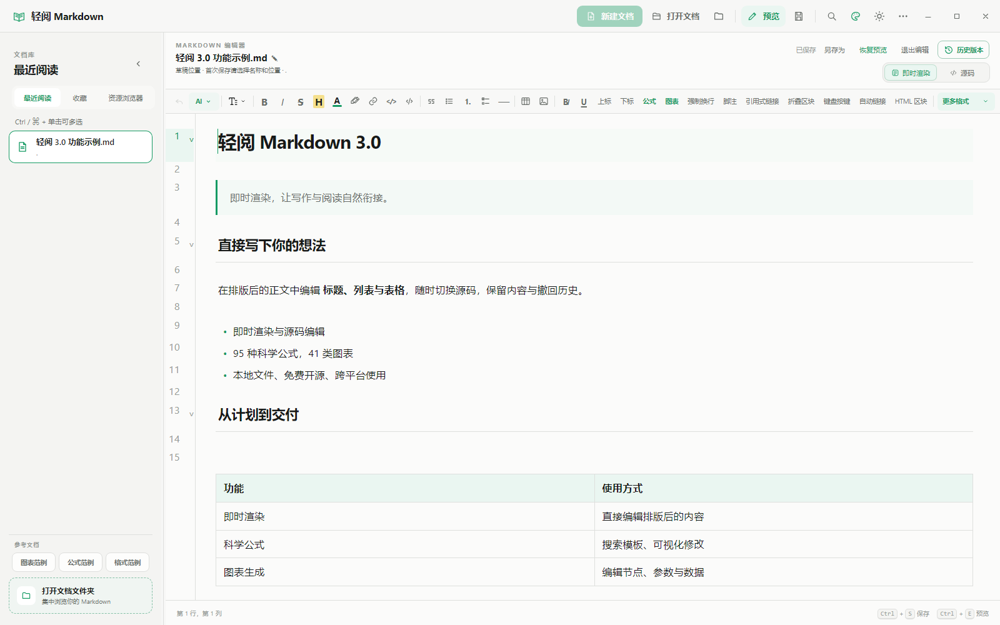

<div align="center">
  
  <h1>轻阅 Markdown</h1>
  <p><strong>阅读优先，编辑顺手的本地 Markdown 工具。</strong></p>
  <p>即时渲染编辑 · 源码与分栏预览 · 图表与公式 · Windows、macOS、Linux</p>
  <p><strong>简体中文</strong> · <a href="README.en.md">English</a></p>
  <p>
    <a href="https://github.com/liuhang798/quillite-markdown/actions/workflows/release.yml"></a>
    <a href="https://qm.ssssa.cn/#download"></a>
    <a href="LICENSE"></a>
  </p>
  <p><a href="https://qm.ssssa.cn/">官方网站</a> · <a href="https://qm.ssssa.cn/#download">下载安装</a> · <a href="#快速上手">快速上手</a> · <a href="#本地开发">从源码构建</a></p>
</div>

轻阅 Markdown 使用 Go + Wails 构建，不依赖 Electron，Windows 安装包约 13 MB。适合阅读长文档、编写 README、维护技术笔记和管理本地 Markdown 文件夹；也支持纯文本 `.txt`。文档保存在本地，不要求注册轻阅账号。

当前发布版本为 **V3.0.0**。本页说明当前软件的使用方式；历史修复和版本变化见 [更新日志](CHANGELOG.md) 与 [v3.0.0 详细记录](docs/releases/3.0.0-details.md)。

## 下载

| 平台 | 安装包 | 官方下载 |
|---|---|---|
| Windows x64 | 分步安装程序 `.exe` | [下载 Windows 版本](https://qm.ssssa.cn/#download) |
| macOS Intel / Apple Silicon | Universal `.dmg` | [下载 macOS 版本](https://qm.ssssa.cn/#download) |
| Linux x64 | `.deb`、`.AppImage` | [下载 Linux 版本](https://qm.ssssa.cn/#download) |

- 官方网站为 **[qm.ssssa.cn](https://qm.ssssa.cn/)**；软件检查更新和下载安装包仅使用该站。GitHub 保留源码、版本记录与构建产物。
- Windows 安装前会显示最终安装路径；普通自定义目录作为父目录，程序使用独立的产品子目录。升级沿用经过归属校验的安装位置；卸载保留用户文档。
- 当前未配置正式 Windows Authenticode / Apple Developer ID 证书，首次安装可能触发 SmartScreen 或 Gatekeeper 提示。更新、文件访问是否需要再次授权取决于系统状态，不能保证完全免提示。
- Windows、macOS 支持应用内下载、校验和更新；无法安全应用时请从官网下载完整安装包。**同版本覆盖不会触发更高版本的升级提示**：已安装旧 V3.0.0 时，可重新下载当前 V3.0.0 安装包。

## 快速上手

退出编辑会恢复进入编辑前的阅读位置，不再强制回到顶部；新打开的文档仍从顶部开始。

1. 点击“打开文档”阅读文件，或点击“新建文档”直接开始编辑；首次手动保存时选择名称与位置。
2. 在编辑标题栏右下方切换“即时渲染／源码”。下表说明点击后的行为。
3. 用工具栏插入表格、图片、公式或图表；空间不足时从“更多格式”找到其他操作。
4. 按 `Ctrl + S` 保存（macOS：`⌘ + S`）。编辑期间每 10 秒尝试自动保存；遇到外部修改冲突时暂停自动覆盖并提供对比处理。
5. 从“导出文档”选择输出格式。左下角及首页的“图表范例／公式范例／格式范例”可直接查看常用写法。

| 操作 | 编辑区 | 分栏预览 |
|---|---|---|
| 点击“即时渲染” | 直接编辑排版后的 Markdown | 自动关闭，让编辑区占满可用宽度 |
| 点击“源码” | 显示 Markdown 语法；长 Base64 图片编码仍显示为短标签 | 自动打开，恢复上次的左右分栏方向 |
| 点击“恢复预览”或预览区关闭按钮 | 保持当前编辑模式 | 单独打开或关闭，后续输入不会覆盖手动选择 |
| 按 `Ctrl / ⌘ + E` | 在编辑与完整阅读预览间切换 | 不等同于“即时渲染／源码”切换 |

模式切换保留正文、选区和撤回历史。软件记住编辑模式与布局；退出再进入编辑会保留手动选择，再次点击模式按钮才重新应用上表的自动开关规则。分栏可交换左右位置，并可拖动分隔线调整宽度。

## 核心功能

### 即时渲染与源码编辑

- 标题、正文、强调、列表、引用、任务、代码块和表格直接在编辑区排版；文字样式菜单提供正文与 H1–H6。
- 表格单元格和代码内容可原位点击、选中、输入；无需为了改一个字展开整块源码。代码块保留底色，区块操作在悬停或键盘聚焦时出现。
- “查看源码／返回渲染”用于单个区块，不必切换整篇文档。复杂或未完成的语法保留源码入口，不强行转换。
- 共享撤回／重做，支持中文输入、常用格式快捷键、多选、查找替换和网页／Word 富文本粘贴。
- 即时渲染不是对所有 Markdown 扩展的完全所见即所得承诺：纯文本、部分复杂语法和超限正文使用源码回退。

### 表格、图片与附件

- 可视化表格设计器支持增删及排序行列、列对齐和列宽；原位单元格编辑可删空后继续输入。
- 支持规则 TSV／HTML 文字表格粘贴，保留空格子、列对齐与撤回；不支持的合并单元格或复杂媒体表格会提示，不直接覆盖原内容。
- 图片支持本地附件、在线地址、引用式图片及 Base64 内嵌；可调整尺寸、左中右对齐和多图同排，也可在表格中插图。
- 源码模式中的长 Base64 图片编码折叠为“格式／大小”短标签。**只是显示省略，复制与保存仍保留完整图片数据**。
- 图片默认存入文档旁的 `assets`；可选内嵌、PicGo Cloud 或本机 PicGo。云端上传失败时回退到已保存的本地附件。
- “便携 Markdown”将可处理的本地图片内嵌到新副本，不改原文档、不删除附件；在线、缺失或复杂图片引用会阻止导出并提示。

### 41 类图表与 95 种公式模板

即时编辑会在中文输入法候选期间保留输入节点，并延后非必要的焦点同步、拼写和公式刷新；连续输入会话不会被上一轮结束回调提前解锁。若 macOS 系统拼音仍异常，可暂切换“源码”编辑并反馈系统版本。

即时编辑中的公式不再因正文达到 30 万字符或数量超过 256 个而停止显示；大文档在本机后台识别，滚动到的公式分批排版。点击“即时渲染”会恢复公式排版；仍可从“更多 → 公式显示 → 公式源码”或单个公式的“查看源码”切换。其他复杂区块的大文档源码回退和公式语法安全限制保持不变。

- **22 类 Mermaid 图表 + 19 类 ECharts 数据图表**：流程图、时序图、甘特图、思维导图、柱线图、饼图、直方图、日历热力图等。
- 常用类型提供画布或数据表编辑；复杂语法保留源码及实时预览。流程图支持表示输入／输出的平行四边形。
- 图表在编辑区直接显示；通过“编辑图表／查看源码”修改，保存后保持原有引擎与 Markdown 围栏。
- **95 种公式模板**覆盖数学、物理和化学，支持可视化结构、参数编辑、行内／块级／编号输出，以及 KaTeX / mhchem 本地渲染。
- 内置范例按类别整理；模板支持范围以当前选择器和范例为准，并非每一种高级图表配置都能转换成可视化表单。

### 阅读与文档管理

- 标题目录、目录搜索与折叠、正文搜索、阅读缩放、八种强调色，以及明暗主题和中英文界面。
- “正文与公式”面板可独立调整正文风格、公式字号和四档正文行距；试看后保存，取消恢复原设置。阅读与即时编辑的行内代码使用明暗适配的浅灰底色。
- Windows“打开所在文件夹”按完整文件路径定位，不再通过同名窗口标题猜测目标。
- 最近阅读、收藏和资源浏览器；最近记录支持置顶、排序及 `Ctrl / ⌘` 多选清除。清除记录不删除原文件。
- 文件名重命名、另存为、历史版本和异常恢复；恢复先进入编辑器，确认保存后才写回文件。
- 保存冲突可对比磁盘版本与当前编辑、另存副本或手动合并，不静默覆盖其他程序的改动。
- 大文档采用延迟高亮和预览优化；隐藏分栏预览时暂停其自动渲染，恢复后显示最新内容。

### 导出与可选辅助功能

- 统一导出入口提供 Word、带样式／无样式 HTML、PDF、高清 PNG/JPEG 和便携 Markdown。
- PDF 优先使用本机 Edge / Chrome / Chromium，失败时可回退系统打印；安装 Pandoc 后可增加 EPUB、RTF、ODT、LaTeX 等格式。
- 离线英文拼写检查、个人词典，以及文档工具中的检查、文件夹搜索和带预览确认的批量替换。
- 可选 AI 编辑与 AI 检查：配置自己的服务和 API Key，主动选择要处理的内容并确认发送；结果可审阅和撤回。API Key 使用系统凭据存储，不写入文档或普通偏好。

## Markdown 支持

| 分类 | 主要内容 |
|---|---|
| 文本 | 加粗、斜体、删除线、高亮、文字颜色、下划线、上下标、行内代码 |
| 结构 | H1–H6、列表、任务、引用、分隔线、代码块、表格、HTML／折叠区块 |
| 引用资源 | 链接、引用式链接、图片、脚注、独立一行的 `[TOC]` |
| 公式与图表 | LaTeX、mhchem 化学式、`\tag{…}` 编号、Mermaid、ECharts |

预览以 CommonMark/GFM 为基础，并提供高亮、脚注等扩展。HTML 经 DOMPurify 清理；不安全的脚本和地址不会作为可执行内容保留。不同阅读器对颜色、图片布局、公式和图表扩展的支持可能不同。

## 隐私与联网边界

- 普通阅读、编辑及公式渲染在本机进行；在线图片、检查更新及主动启用的云端功能需要联网。
- “参与产品改进计划”只控制异常日志。启用后发送清理本地路径后的错误信息、系统类型、版本及服务器解析的地域；关闭后不再提交错误日志。
- 匿名每日活跃统计独立运行，每台设备每天最多提交一次安装标识、版本、系统类型和架构；服务器保存标识的不可逆哈希及解析后的地域，不保存来源 IP。不包含文档、文件名、路径、联系方式或具体操作行为。
- 意见反馈仅发送用户填写的内容、主动上传的截图、可选联系方式及软件／系统版本；服务器记录请求 IP 与地域，供管理员处理，不自动附带当前文档。
- AI 请求在用户确认后发送到所选服务；图床上传按所选存储方式发送图片。使用前请核对服务提供方的隐私与费用规则。

## 项目截图

V3.0.0 实际界面，使用示例文档拍摄；截图会随浏览器的明暗偏好选择对应版本。

即时渲染编辑：直接在排版后的正文、列表和表格中输入。

<picture>
  <source media="(prefers-color-scheme: dark)" srcset="screenshots/dark/04-live-editor.png">
  
</picture>

| 首页 | 阅读界面 |
|---|---|
| <picture><source media="(prefers-color-scheme: dark)" srcset="screenshots/dark/01-home.png"></picture> | <picture><source media="(prefers-color-scheme: dark)" srcset="screenshots/dark/02-reader.png"></picture> |

源码编辑与分栏预览：点击“源码”自动恢复分栏，也可交换左右位置。

<picture>
  <source media="(prefers-color-scheme: dark)" srcset="screenshots/dark/03-split-editor.png">
  
</picture>

模式联动与按钮操作见“快速上手”；[完整截图与拍摄说明](screenshots/README.md)包含中英文和明暗主题版本。

## 本地开发

技术栈：**Go 1.25、Wails 2.13、Node.js 22、Vite、CodeMirror 6**。还需安装 Wails 对应平台的系统依赖。

在仓库根目录运行：

```bash
go install github.com/wailsapp/wails/v2/cmd/wails@v2.13.0
cd frontend
npm ci
cd ..
wails dev
```

测试与生产前端构建：

```bash
cd frontend
npm test
npm run build
cd ..
go test ./...
go vet ./...
node scripts/test-release-safety.mjs
```

前端必须先构建，Go 程序才有可嵌入的 `frontend/dist`。浏览器回归使用隔离合成文档，需提供 Playwright 和 Chromium；可通过 `PLAYWRIGHT_MODULE`、`BROWSER_EXECUTABLE` 指定路径。最新模式联动回归为 `frontend/tests/browser-mode-preview-link.mjs`，其他专题见 [测试说明](docs/testing.md)。

Windows 完整安装包需在 PowerShell 中执行两步：

```powershell
$version = (Get-Content wails.json | ConvertFrom-Json).info.productVersion
$installer = "build/bin/quillite-markdown-$version-windows-amd64.exe"
wails build -clean -platform windows/amd64 -nsis -installscope user -webview2 embed -trimpath
./scripts/build-windows-launcher.ps1 -CoreInstaller $installer -Output $installer
```

NSIS 核心包不是最终交付文件；封装脚本会校验自定义安装界面与 `QUILLITE_PAYLOAD` 标记。不要在日常电脑上运行安装／升级／卸载生命周期测试，相关脚本仅允许一次性 GitHub Windows runner。

macOS 通用版：

```bash
bash scripts/build-macos.sh darwin/universal
```

发布流程与官网同步配置见 [发布指南](RELEASING.md)。仅修改文档无需移动版本标签或重新发布安装包。

## 项目文档

- [更新日志](CHANGELOG.md) · [v3.0.0 逐项记录](docs/releases/3.0.0-details.md)
- [贡献指南](CONTRIBUTING.md) · [测试说明](docs/testing.md) · [安全策略](SECURITY.md)
- [AI 项目技术指南](AGENTS.md) · [发布指南](RELEASING.md)
- [开发分支内存优化、打印图片完整性与复测记录](docs/resource-lifecycle.md)
- [官网源代码](https://github.com/liuhang798/quillite-markdown-website)
- [MIT 开源协议](LICENSE)
